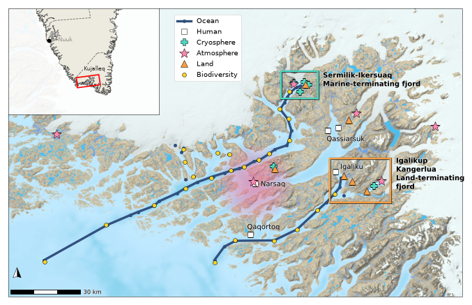

# Overview map of the sampling programme



## Why this figure

The overview map shows where the GreenFjord project sampled in South Greenland,
by cluster, on one base map. It sets the geographic context for the rest of the
figures: the two intensively studied fjords (marine-terminating
Sermilik-Ikersuaq and land-terminating Igalikup Kangerlua) are boxed, and the
locator inset places the area within southern Greenland.

With the current sheet and config the map shows 47 ocean stations (28 on the
glacial-fjord transect, 10 on the land-fjord transect, 9 loose) and, after
thinning and manual edits, 5 Human, 6 Cryosphere, 6 Atmosphere, 6 Land and
25 Biodiversity sites.

## How to read it

- **Ocean (dark blue line and dots):** CTD stations, joined along the ship's
  track for the two fjord transects (each continues onto the shelf); loose
  stations are bare dots.
- **Markers by cluster:** white square = Human, teal plus = Cryosphere, pink
  star = Atmosphere, orange triangle = Land, yellow circle = Biodiversity.
  Later layers in `analysis.layers` are drawn on top.
- **Boxes:** the two studied fjords. The box colour matches the Cryosphere
  (teal) and Land (orange) markers.
- **Pink blob around Narsaq:** the diffuse aerosol source region. It has no
  hard boundary, so it is drawn as nested translucent ellipses.
- **Scale bar and north arrow** (grid north at the map centre), bottom left.
- **Inset (top left):** southern Greenland with the main map's extent as a red
  box and the Kujalleq municipality border dashed.

## Data

| Input (`config_MAP.yaml` -> `inputs`) | Contents | Source |
|---|---|---|
| `sample_locations`: `data/greenfjord_sample_locations.csv` | Master sampling sheet (cluster, type, lat/lon, location, station ID); see [`data/README.md`](data/README.md) | GreenFjord project Google Sheet, S1 |
| `basemap_wmts_url` / `basemap_wmts_layer` | GEUS 1:250 000 topographic map of Greenland (UTM 24N), remote WMTS service | GEUS, layer `Greenland_G250_Topographic_Map_UTM24N`, S2 |
| `municipalities`: `../../data/geoboundaries_grl_adm1/geoBoundaries-GRL-ADM1.geojson` | Municipality boundaries, inset only | geoBoundaries GRL ADM1 (2020), S31 |
| (cartopy download) | Natural Earth 1:10 m land and coastline, inset only | Natural Earth, S3 |

See [`DATA_SOURCES.md`](../../DATA_SOURCES.md) (S1, S2, S3, S31) for citations.

## Methods

Implementation: `plot_MAP.py`.

1. **Read** the sheet (`load_samples`), skipping the instruction row.
2. **Ocean** (`build_ocean`, `transect_index`): select the `Ocean` cluster.
   Each transect takes the stations whose `Location` starts with its prefixes,
   plus the shelf stations split by the first letter of `Station ID`
   (`L...` continue the land-fjord line); the glacial transect also takes the
   cryosphere CTD casts. Stations closer than `merge_dist_m` are merged
   (`merge_adjacent`) and ordered nearest-neighbour from the most remote station
   (`sort_by_distance`). Leftover stations are merged with their own threshold
   and drawn as dots only.
3. **Marker layers** (`build_marker_layer`): filter each cluster by type or
   location prefix, then merge points within `merge_dist_m` to their midpoint.
   `Land` is instead averaged per named site (`group_by_location`).
4. **Manual edits** (`apply_edits`): add or drop sites as set in
   `analysis.edits`.
5. **Draw** (`build_figure`): marker layers, highlight boxes and legend, WMTS
   basemap, settlement names, aerosol blob, scale bar and north arrow, then the
   locator inset (`add_inset`).

Distances are measured in UTM 24N (`analysis.work_epsg`).

## Caveats

- The basemap is a live WMTS service, so the figure needs network access and
  changes if GEUS changes the service.
- The sheet is unversioned. Re-running the download changes the figure whenever
  the sheet has changed.
- Merging decides which rows survive; the plotted position is the surviving
  row's own `Lat`/`Lon`, not the merged midpoint.
- The Cryosphere cluster is spelled `Cryoshpere` in the sheet and the config
  matches that spelling.
- Atmosphere sites at Kangerlussuaq (about 450 km north) are excluded so they do
  not stretch the map extent.
- The Igaliku river and Igaliku glacier sites are manual additions that are not
  in the sheet (requested by Lisa Bröder, 2025-07-11).
- Rendering depends on the shared paper style: `plot.style` restores
  `font.size: 10`, which sets the size of the scale bar and north arrow.

## Run

From the repository root:

```bash
MPLCONFIGDIR="$TMPDIR/mpl" .venv/bin/python fig1-map_samples/plot_MAP.py
```

All settings live in `config_MAP.yaml`. Outputs: `fig_MAP.<fmt>` for each of
`output.formats` (png and pdf), at `output.dpi`.

To refresh the sampling sheet first:
`.venv/bin/python fig1-map_samples/data/download_sample_locations.py`.

Marker-layer order (drawing and legend order) is set by `analysis.layers`; the
colours and sizes are in `plot.markers.layers`. Original notebook and helpers
are in `archive/examples/`.

## References

- GEUS G250 topographic map of Greenland, metadata record
  f3c6c2e4-f161-4c42-83a4-b7acbd127980 (metadata.geus.dk).
- Runfola, D. et al. (2020) geoBoundaries. *PLoS ONE* 15(4), e0231866,
  doi:10.1371/journal.pone.0231866.
- Natural Earth, 1:10 m physical vectors (naturalearthdata.com).

Part of the GreenFjord overview-figures set.
