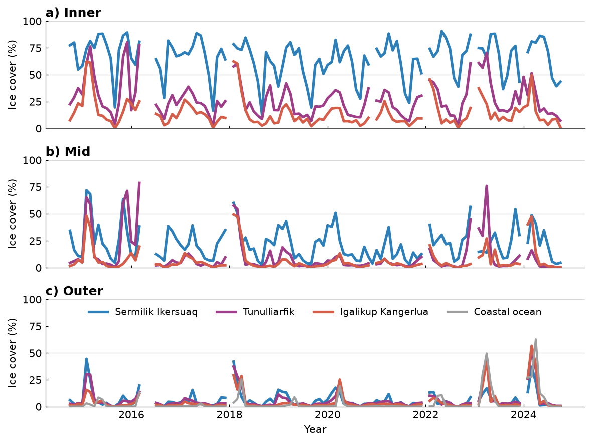

# Fig 10 — Fjord ice-cover time series



Monthly sea-ice cover (%) in the **Inner**, **Mid** and **Outer** zones of
three South Greenland fjords: Sermilik Ikersuaq, Tunulliarfik and Igalikup
Kangerlua, from 2014-10 to 2024-10.

## Why this figure

It shows how ice cover differs between fjords and along each fjord, and how
it varies from year to year. The main take-aways:

- **Ice cover falls from the head to the mouth of every fjord.** Over the
  record the mean cover of Sermilik Ikersuaq is 65 % (Inner), 22 % (Mid) and
  6 % (Outer). The other two fjords are lower throughout (Tunulliarfik 27, 11
  and 6 %; Igalikup Kangerlua 15, 7 and 5 %).
- **Sermilik Ikersuaq is the most ice-covered fjord**, particularly in the
  inner zone, where monthly values reach 91 %.
- **The Outer zones follow the coastal ocean.** Ice cover there is near zero
  for most months and peaks in only a few winters, notably 2015, 2018, 2023
  and 2024, when the coastal-ocean series also peaks (up to 63 %).

## How to read it

Each panel is one fjord zone, with the zone and panel letter (a, b, c) above
it. Each coloured line is one fjord (blue Sermilik Ikersuaq, purple
Tunulliarfik, terracotta Igalikup Kangerlua). The grey line in panel c is the
coastal-ocean ice cover, which is not part of any fjord. The y axis is ice
cover in % of the zone area; light grey lines mark 50 % and 100 %. Gaps in
the lines are months with no data (7 to 8 of the 121 months per series).

## Data

| Input (`config_FJORD_ICE_TIMESERIES.yaml` → `inputs`) | Contents | Source |
|---|---|---|
| `ice_cover`: `../../data/fjord_ice_regions_monthly/fjord_ice_regions_monthly.xlsx` | Sheet `seaice_conc`: monthly sea-ice cover (%) per fjord and zone, plus an `Oceanic / Coastal ocean` series. 121 months, 2014-10 to 2024-10. | S20 in [`DATA_SOURCES.md`](../../DATA_SOURCES.md); the provider is not recorded in the workbook (probably DMI ice charts) |

## Methods

1. `read_ice_cover` reads the sheet, which has two header rows (fjord, zone),
   and converts the values to numbers (non-numeric entries become gaps).
2. `plot_fjord_lines` draws one line per fjord for each zone, and
   `style_axis` sets the axes, reference lines and ticks.
3. `plot_coastal_ocean` adds the coastal-ocean line to the Outer panel.

No further processing is done: the lines are the workbook values.

## Caveats

- The data provider is not recorded in the workbook; see S20 in
  [`DATA_SOURCES.md`](../../DATA_SOURCES.md).
- The workbook headers are used as they are, including the trailing space in
  `"Inner "` and the spelling `"Sermelik - Ikersuaq"`. Legend labels come from
  the config (`label`) and use the spellings "Sermilik Ikersuaq" and
  "Tunulliarfik".

## Run

From the repository root:

```bash
MPLCONFIGDIR="$TMPDIR/mpl" .venv/bin/python figures/fig10_FJORD_ICE_TIMESERIES/plot_FJORD_ICE_TIMESERIES.py
```

Writes `fig_FJORD_ICE_TIMESERIES.png` and `.pdf` next to the script. All
settings (fjord names and colours, zones, line widths, axis limits, output
formats and DPI) are in `config_FJORD_ICE_TIMESERIES.yaml`.

## References

- Data: see S20 in [`DATA_SOURCES.md`](../../DATA_SOURCES.md).
