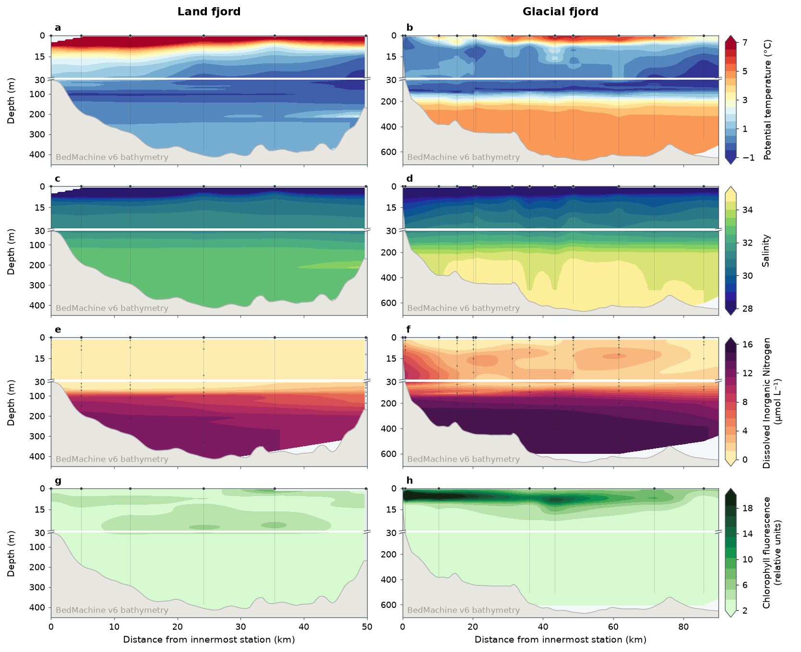

# 2024 CTD sections of the land and glacial fjord

Distance–depth sections of potential temperature, salinity, dissolved
inorganic nitrogen (DIN) and chlorophyll fluorescence along the land fjord
(left) and the glacial fjord (right), from the 2024 GreenFjord cruise.



## Why this figure

It puts the physical, chemical and biological structure of the two study
fjords side by side. Each variable has one colour scale for both fjords, so
differences in water-mass properties, nutrient supply and the depth of the
chlorophyll maximum can be compared directly. The upper 30 m, where most of the
biological activity happens, is drawn on an expanded axis without losing the
full water column below it. Check any numbers quoted from this figure against
the current output before using them.

## How to read it

- **Columns:** land fjord (fjord 56, workbook name `eastern`) and glacial fjord
  (fjord 54, workbook name `western`).
- **Rows (a–h):** potential temperature, salinity, DIN, chlorophyll
  fluorescence, each with its own colour bar on the right. Values outside the
  colour limits are kept and shown by the extended ends of the colour bar.
- **x axis:** distance from the innermost sampled station of that fjord (km),
  increasing seaward. Each section spans its configured limits.
- **y axis:** depth (m), split at `depth_split.depth_m` (30 m). The upper axis
  takes one third of the panel height and the lower axis two thirds. The `//`
  marks at the left and right edges show the change in vertical scale.
- **Dark dots at the surface:** CTD stations. **Thin vertical lines:** extent of
  each cast.
- **Small dots in the DIN row:** bottle-sample locations, because nutrients
  were measured only at selected depths.
- **Light grey area:** BedMachine v6 seabed, labelled in each lower axis with
  the cross-fjord aggregation used (`analysis.bathymetry.agg_method`). The
  interpolated field is masked below the seabed.

## Data

See [`DATA_SOURCES.md`](../../DATA_SOURCES.md) for citations.

| Input (set in `config_CTD_SECTIONS.yaml` → `inputs`) | Contents | Source |
|---|---|---|
| `hydrography`: `data/GF24_phys_nut_dTM_v300625_for_Luke.xlsx` (sheet `data`) | 2024 CTD profiles at 1 m depth resolution with bottle nutrients. Columns used: `FEJORD`, `Station_ID`, `dist_from_1st` (km), `Depth` (m), `Bottom Depth`, `Latitude`, `Longitude`, `CTD_Type`, `Potential_Temperature` (°C), `Salinity`, `DIN` (µmol L⁻¹), `Chla` (relative units) | Maxi's 2024 GF24 workbook from the GreenFjord ocean cluster (S27 in `DATA_SOURCES.md`, internal, no citation yet). Idronaut and Seabird CTDs |
| `bathymetry`: `../../data/fjord_bathymetry/fjord_bathymetry_{agg_method}_fjord_{fjord_num}.nc` | BedMachine bed elevation (`bathymetry`, m, negative below sea level) along the fjord centreline, versus `distance_to_glacier_km` (km, 0.5 km spacing). Fjord 56 = land fjord, fjord 54 = glacial fjord | Shared dataset, see [`../../data/fjord_bathymetry/README.md`](../../data/fjord_bathymetry/README.md). BedMachine Greenland v6 (S25) aggregated on the fjord centreline geometry (S26, source of the shapefiles still unknown) |

Files that are not used by the script (an email from Maxi, a 10 m raster, an
older interpolated-stations table and the example screenshots) are in
`archive/`.

## Methods

Implementation: `plot_CTD_SECTIONS.py`. Settings in `analysis` of the config.

1. **Select data.** `load_hydrography` reads the workbook and checks the
   columns. Per variable and fjord, `analysis.variables.<column>.station_filter`
   can restrict the rows. Fluorescence uses only `CTD_Type == "Idronaut"`.
2. **Interpolate.** `interpolate_section` interpolates the scattered
   distance–depth values onto a regular grid (`analysis.grid.distance_step_km`,
   `depth_step_m`), only inside the convex hull of the measurements. Duplicate
   distance–depth pairs are averaged. The method is set globally
   (`analysis.grid.method`) and per variable (`interpolation_method`):
   - `cubic`: Clough–Tocher piecewise-cubic interpolation, constrained to the
     observed range of each variable and fjord (`clip_to_data_range`). It is
     the scattered-data analogue of bicubic interpolation.
   - `linear`: used for DIN, where bottle samples are too sparse for cubic
     interpolation.
   - `idw`: anisotropic inverse-distance weighting, used for potential
     temperature, salinity and fluorescence. The elliptical distance is
     `r = sqrt((dx / distance_scale_km)² + (dz / depth_scale_m)²)` and weights
     are proportional to `r^(-power)` over the nearest `neighbors` (32)
     observations. Exact observation locations reproduce their values. IDW
     stays within the input range without clipping. Local neighbour selection
     can cause small discontinuities when the neighbour set changes. With
     `"auto"`, the horizontal scale is the mean gap between unique station
     distances and the vertical scale is the mean of each profile's mean gap
     between sampled depths. Bottle samples therefore get different scales from
     CTD profiles. These are sampling-density heuristics, not fitted correlation
     lengths. With distances in km and depths in m, the kernel is physically much
     wider horizontally. Numeric scales (e.g. `distance_scale_km: 10`,
     `depth_scale_m: 5`) set the aspect ratio; multiplying both by the same
     factor changes nothing. With `extrapolate: false` the convex-hull mask is
     kept.
   - `nearest` is also available.
3. **Smooth.** `smooth_masked_field` applies a Gaussian filter
   (`smoothing.distance_km`, `smoothing.depth_m`) to valid cells only, so the
   no-data mask is preserved.
4. **Bottom hold.** `extend_field_downward` carries the deepest valid value of
   each distance column down to the bottom of the section
   (`vertical_extrapolation: "bottom_hold"`). No horizontal extrapolation is
   applied (`extrapolate: false`).
5. **Bathymetry.** `load_bathymetry` reads the BedMachine section for each fjord
   (`analysis.bathymetry.agg_method`: `min` = deepest cell per cross-fjord
   polygon, `median`, `mean`, `max`) and smooths it with a centred rolling mean
   of `smooth_km` (2 km). The section keeps its distance-from-glacier
   coordinates; the hydrography keeps its distance-from-innermost-station
   coordinates. Neither depends on sampling depth or x limits.
6. **Plot.** `plot_section_panel` draws each field twice, on the shallow and the
   deep axis, with the seabed, stations and samples. Both axes share the x axis.

**Fluorescence choice.** The fluorescence sensor was not calibrated, so the
figure shows relative instrument units, not chlorophyll-a concentration. The
Idronaut `Chla` channel is used because it occurs in both fjords. The Seabird
`Fluorescence_ECO_AFL_FL` channel has a different baseline and scale and is not
merged with it. This avoids a false cross-instrument comparison.

## Caveats

- Fluorescence is uncalibrated and Idronaut-only, so it has fewer usable casts
  than temperature and salinity. Compare patterns, not absolute values.
- Nutrients come from bottle samples at selected depths. The DIN field is a
  heavily smoothed linear interpolation between sparse points, and it is
  constrained by the sample locations shown as dots.
- Below the deepest observation at each distance the value is held constant, so
  the near-bottom field is not measured information. The seabed mask hides only
  what lies below the BedMachine bathymetry.
- Interpolated fields depend on the method and smoothing chosen per variable.
  Cubic interpolation can overshoot (hence the clipping), and IDW kernels are
  heuristic.
- The bathymetry is a long-section statistic of BedMachine across fjord
  polygons, not the depth below each CTD cast. `agg_method` changes the
  depicted seabed. The geometry source of the polygons (S26) is undocumented.
- The workbook labels the fjords `eastern` and `western`. The figure uses the
  project terms land fjord (56) and glacial fjord (54).
- No cache is used.

## Run

From the repository root:

```bash
MPLCONFIGDIR="$TMPDIR/mpl" .venv/bin/python fig11-CTD_SECTIONS/plot_CTD_SECTIONS.py
```

All settings live in `config_CTD_SECTIONS.yaml`. Outputs are
`fig_CTD_SECTIONS.<fmt>` for each of `output.formats` (default png and pdf) at
`output.dpi`. Settings that matter most:

- `analysis.bathymetry.agg_method`: `"min"`, `"median"`, `"mean"` or `"max"`;
  the matching `fjord_bathymetry_<method>_fjord_<number>.nc` must exist in
  `../../data/fjord_bathymetry/`. The in-figure label follows it.
- `analysis.grid.method` and `analysis.variables.<column>`: interpolation method,
  smoothing and station filter per variable.
- `plot.depth_split`: depth and height ratio of the expanded upper axis.
- `plot.axes.show_station_labels_on_row`: row number on which to print station
  IDs (default `null`).
- `plot.transects[].xlim`: a range in km, or `"data"` for the station extent.

## Suggested caption

**Physical, chemical and biological structure along the GreenFjord 2024
transects.** Potential temperature, salinity, dissolved inorganic nitrogen (DIN)
and chlorophyll fluorescence (uncalibrated, relative units) for the land fjord
(left) and glacial fjord (right). Distance increases seaward from the innermost
sampled station. Filled circles mark CTD stations, vertical lines show cast
extent, and dots in the DIN panels show bottle-sample locations. The upper 30 m
is shown on an expanded depth axis. Temperature, salinity and fluorescence use
inverse-distance weighting, DIN uses linear interpolation, all within the
sampled distance–depth domain; below the deepest observation at each distance
the value is held constant to the seabed. Light grey shows BedMachine v6
bathymetry (deepest cell per cross-fjord polygon, 2 km rolling mean, as in the fish figure).

## References

- Morlighem, M. et al. (2017) BedMachine v3: complete bed topography and ocean
  bathymetry mapping of Greenland. *Geophys. Res. Lett.* 44,
  doi:10.1002/2017GL074954.
- Morlighem, M. et al. (2025) IceBridge BedMachine Greenland, Version 6. NSIDC,
  doi:10.5067/6B6B225B8V2D.
- Shepard, D. (1968) A two-dimensional interpolation function for irregularly
  spaced data. *Proc. 23rd ACM National Conference*, 517–524 (inverse-distance
  weighting).
- Clough, R. W. & Tocher, J. L. (1965) Finite element stiffness matrices for
  analysis of plate bending. *Proc. 1st Conf. Matrix Methods in Structural
  Mechanics* (Clough–Tocher interpolation).

Part of the GreenFjord overview-figures set.
