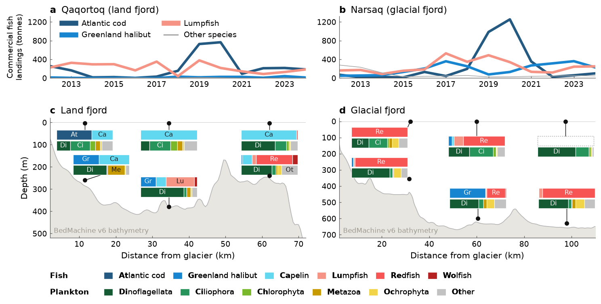

# Fig 12 — Fish landings and eDNA community composition



Commercial fish landings in the two study districts (panels a, b) and the
eDNA community composition along the land-fjord and glacial-fjord
long-sections (panels c, d).

## Why this figure

It sets the fishery of the two districts beside what the water itself
contains. Panels (a, b) show annual landings 2012–2024 for Qaqortoq (land
fjord) and Narsaq (glacial fjord): Atlantic cod, Greenland halibut and lumpfish
each get a line, and all other species are pooled. Panels (c, d) show the fish
(MiFish 12S) and plankton (EukAtara 18S) eDNA communities at the 2023
GreenFjord stations, placed on a BedMachine long-section of each fjord.

## How to read it

- **(a, b)** Lines are annual landings in tonnes: Atlantic cod, Greenland
  halibut, lumpfish (thick, coloured) and "Other species" (thin grey, the sum
  of everything else in the table). The panels share the y range (0–1320 t).
- **(c, d)** Axes are distance from the glacier (km) and depth (m, inverted).
  The grey fill is the seabed (thalweg, smoothed over 2 km). Each station is a
  black dot at its sampling depth, joined by a leader line to a two-row
  "flag": the upper bar is the fish community (MiFish), the lower bar the
  plankton community (EukAtara). Both are 100 % stacked bars of read counts.
  Segments at least 24 % wide carry a two-letter code, decoded by the bold
  letters in the legends below.
- **Dashed empty bar:** no reads for that assay at that station. Only
  `GF23_K_2m` is affected (no fish reads).
- Fish colours are blues and reds, plankton colours greens and yellows,
  "Other" is grey. Species keep the same colour in (a, b) and (c, d).
- Panels are lettered left to right, top to bottom: (a) Qaqortoq, (b) Narsaq,
  (c) land fjord (#56), (d) glacial fjord (#54).

## Data

| Input (`config_FISH.yaml` → `inputs`) | Contents | Source |
|---|---|---|
| `fish_catch`: `data/fish_catch/FIX012_20241112-130447.csv` | Landings (tonnes) by district, species, fishing segment, vessel type and month, 2012–2024; `-` marks missing | Statistics Greenland table FIX012, downloaded 2024-11-12 (S22) |
| `edna_fish`: `data/edna/share_mifish_greenfjord_tablefull.csv` | MiFish 12S read counts per sequence and station, with taxonomy and sampling metadata | GreenFjord 2023 eDNA (S23, internal) |
| `edna_plankton`: `data/edna/share_eukatara_table.csv` | EukAtara 18S read counts per taxon (Class) and station; also supplies each station's depth and position | GreenFjord 2023 eDNA (S24, internal) |
| `bathymetry`: `../../data/fjord_bathymetry/fjord_bathymetry_{agg_method}_fjord_{fjord_num}.nc` | BedMachine v6 bed along each fjord centreline, 0.5 km spacing (`bathymetry`, m, vs `distance_to_glacier_km`); fjord 54 runs 0–123 km, fjord 56 0–77.5 km | BedMachine Greenland v6 (S25) aggregated on the fjord geometry (S26); see [`data/fjord_bathymetry/README.md`](../../data/fjord_bathymetry/README.md) |
| `fjord_pickle`: `../../data/fjords/fjord_{fjord_num}/fjord_aggregator.pkl_joblib` | Fjord centreline and cross-section geometry, used to place stations | S26, built by `greenland-fjord-properties` (origin of the input shapefiles unknown) |

See [`DATA_SOURCES.md`](../../DATA_SOURCES.md) (S22–S26) for citations and open
gaps. Stations are Z, W, V (land fjord) and B, D, K (glacial fjord); each has
a surface (2 m) and a deep cast. Station E lies in a side fjord that belongs
to neither transect and is excluded.

## Methods

Implementation: `plot_FISH.py`, driven entirely by `config_FISH.yaml`.

1. **Landings** (`load_landings`). Missing values are set to NaN, monthly and
   vessel-type rows are summed to annual totals per district and species. The
   three species in `analysis.landings.species` are kept, and every other
   species in the table (13 further categories) is summed into "Other species".
2. **eDNA groups** (`load_compositions`). Fish reads are grouped by
   `scientific_name` into the groups in `analysis.edna.fish_groups`; the
   remainder is "Other". The two sequences in `gadus_morhua_sequences` are
   re-assigned to *Gadus morhua* first, following the correction in
   `archive/examples/edna_plot.R`. Plankton reads are grouped by Class, keeping
   the five in `plankton_classes`. Read counts are summed per station and group
   and normalised to 100 %.
3. **Bathymetry** (`load_bathymetry`, `plot_transect`). The shared section is
   read as is (`bathymetry_agg_method: min`) and smoothed with a 2 km rolling
   mean (`bathymetry_smooth_km`).
4. **Station distance** (`centerline_distances`). Each station is snapped to
   the nearest cross-fjord polygon of the fjord centreline (500 m grid,
   `centerline_grid_m`), and its distance from the glacier is read there.
5. **Flags** (`draw_flag`, `draw_leader`). Bar size is a fraction of each
   panel's own axis ranges, so the bars look identical in both panels. Flag
   positions come from `plot.panels.transects.flags.placement` (`auto` takes the
   station's own coordinate). Label text colour is chosen from fill luminance.

## Caveats

- **Thalweg, not median, bathymetry.** The shared dataset can aggregate
  BedMachine across each cross-fjord polygon with several statistics. `median`
  averages in the fjord walls: the section comes out rough and 150–250 m too
  shallow, which puts the deep casts (355–630 m) inside the rock. `min` takes
  the deepest cell per polygon (the thalweg), which is smoother and consistent
  with the shipboard seafloor depths in the eDNA metadata. There is no
  per-figure cache: to change the method, set `bathymetry_agg_method` and, if
  that file does not exist, regenerate the shared dataset with
  `data/fjord_bathymetry/download_fjord_bathymetry.py`.
- **Station distances come from the centreline**, not from the hand-digitised
  values in `archive/examples/edna_plot.R` (`manual_distance_km`: 27/57/92 km
  for B/D/K and 7/30/58 km for Z/W/V). In an earlier run the centreline values
  were about 4–5 km larger (32/60/98 and 11.5/34.5/62 km), because the
  centreline starts at the head of the catchment rather than at the present-day
  terminus. This was not re-checked for this version. Set
  `distance_from_centerline: false` to use the manual values.
- **"Other" is large in most fish bars.** About 333 k MiFish reads, the biggest
  single block in the dataset, are assigned only to the genus *Gadus* at 100 %
  identity. 12S cannot split these between Atlantic cod (*G. morhua*) and
  Greenland cod (*G. ogac*), and calling them Atlantic cod would be an
  identification decision, so they stay in "Other". Atlantic cod therefore
  appears mainly through the two corrected sequences. Adding
  `Gadus: Atlantic cod` to `edna.fish_groups` makes the other call, and is the
  one change that would alter the figure a lot.
- **Read counts are relative.** Bars are shares of reads within one assay and
  station, not abundances, and cannot be compared with landings.
- **x ranges are trimmed** (2–72 km land, 2–110 km glacial) to drop the shallow
  skerries at the fjord mouths; the data extend further.
- **Mock-up.** `archive/examples/new_plot.png` is the layout mock-up this figure
  started from. Its landings curves are invented and its legend says
  "Illustrative bathymetry"; this script keeps the layout but plots real data.

## Run

From the repository root:

```bash
MPLCONFIGDIR="$TMPDIR/mpl" .venv/bin/python figures/fig12_FISH/plot_FISH.py
```

Outputs are `fig_FISH.<fmt>` for each of `output.formats` (png and pdf), at
`output.dpi` (300). Settings in `config_FISH.yaml` that matter most:
`analysis.landings.species`, `analysis.edna.fish_groups`,
`analysis.transects.distance_from_centerline`, `bathymetry_agg_method`, and the
`plot.layout` fractions and `flags.placement` for spacing. Old scripts, the R
originals and the earlier config are in `archive/`.

## References

- Statistics Greenland, table FIX012, <https://bank.stat.gl/pxweb/da/Greenland/Greenland__FI__FI10/FIX012.px/> (accessed 2024-11-12).
- Morlighem, M. et al. (2025) IceBridge BedMachine Greenland, Version 6.
  NSIDC, doi:10.5067/6B6B225B8V2D.
- Morlighem, M. et al. (2017) *Geophys. Res. Lett.* 44, doi:10.1002/2017GL074954.
- MiFish 12S primers: Miya, M. et al. (2015) *R. Soc. Open Sci.* 2, 150088.

Part of the GreenFjord overview-figures set.
