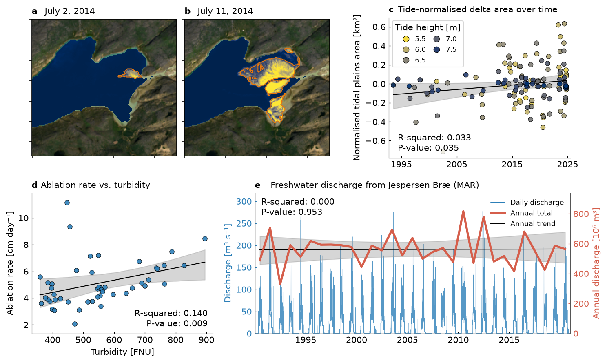

# Fig 14 — Tidal-flat growth and glacial sediment delivery

Five panels on the tidal flats of a fjord near Qaqortoq, southern Greenland,
and the meltwater that feeds them: (a, b) Landsat maps with the flats outlined,
(c) tide-normalised tidal-plain area 1993-2024, (d) ablation rate vs. turbidity,
(e) Jespersen Bræ freshwater discharge.



## Why this figure

It asks whether the tidal flats are growing and whether glacial meltwater is a
plausible sediment source. Panels (a, b) show how much the exposed flats can
differ between two scenes only nine days apart (2014-07-02 and 2014-07-11).
Panel (c) puts the flat area on a common tide height: the trend is slightly
positive (R² = 0.033, p = 0.035, n = 137 scenes) but weak and noisy, with a large
scatter after 2015. Panel (d) links melt and sediment in the 2023 logger data:
higher turbidity goes with faster ablation (R² = 0.140, p = 0.009, 47 daily pairs).
Panel (e) shows that modelled discharge has a strong seasonal cycle but no
trend in the annual total (R² = 0.000, p = 0.953, 31 years).

## How to read it

- **(a, b)** RGB true-colour land, SWIR reflectance over the water (cividis:
  dark blue = water, yellow = exposed flats), orange outline = tidal-flat mask.
  Titles are the scene dates actually used (nearest netCDF scene to the
  requested date).
- **(c)** One dot per Landsat scene; colour = tide height at scene time (m).
  Black line = OLS fit, grey band = 99 % bootstrap confidence interval
  (`analysis.regression.ci`). The y value is the area residual after removing the
  logistic dependence on tide height (km²).
- **(d)** One dot per day with both loggers reporting. Same fit and band.
- **(e)** Blue = daily discharge (m³ s⁻¹, left axis); red = annual total
  (10⁶ m³, right axis); black line and grey band = trend through the annual
  totals. The R²/p box refers to that trend. Years are placed at 1 July.

## Data

All inputs are in `data/` (used by this figure only), set under `inputs:`.
Full citations: [`DATA_SOURCES.md`](../../DATA_SOURCES.md) (S11, S28, S29, S30).

| Input | Contents | Source |
|---|---|---|
| `landsat-rgb_and_tidal_flats-cleaned-1993-2024.nc` | 138 cleaned Landsat scenes, 1993-2024, UTM 23N (EPSG:32623) 168 x 178 grid at ~45.3° W, 60.9° N: `rgb` (reflectance) and `tidal_flats` (0/1 mask, swir16 > 0.03) | Landsat C2 L2 via Microsoft Planetary Computer (USGS/NASA) |
| `area_tide_height_fit.csv` | Per scene: `tide_height` (m), tidal-plain area (km²), logistic tide-detrended area `tidal_plain_area_logistic_norm_to_tide_height` (plotted y), `time_dt0` (days since first year, plotted x) | Tide height from a UTide harmonic fit to the Qaqortoq tide gauge, 2005-2024 (DTU Space; PSMSL 980/045; also archived at UHSLC) |
| `CR300_SouthGreenland.txt` | Turbidity logger, 2023: `CV_Mean_Turb` (FNU) | Ian Delaney's 2023 field sensors |
| `CR1000_Ablato_store.dat` | Ablatometer, 2023, 3-hourly: `ablato_mMeter` (distance to ice, mm) | Ian Delaney's 2023 field sensors |
| `freshwater_JB.csv` | Daily MAR liquid discharge at Jespersen Bræ, `freshwater_discharge_MAR` (m³ s⁻¹), ends 2021-01-01 | Mankoff et al. (2020), GEUS Dataverse doi:10.22008/FK2/XKQVL7 |

The map background (RGB + `swir16`) is fetched from Planetary Computer
(`landsat-c2-l2`, 30 m, same grid as the netCDF) and cached in `cache/`.

## Methods

1. **Map scenes** (`get_scene`, `fetch_scene`): each requested date snaps to the
   nearest scene in the netCDF; the Landsat acquisition closest to it is fetched
   (+/- 1 day window, cloud cover < `max_cloud_cover`), reindexed onto the netCDF
   grid, and cached. stackstac 0.5.0 needs two small NumPy 2 / pandas 3 shims
   (`install_stackstac_shims`), applied only when fetching.
2. **Maps** (`plot_map`): RGB stretched to `rgb_vmax`; SWIR over the fjord footprint
   minus its median, clipped at 0, drawn with the `swir_*` colour scale; contour of
   `tidal_flats` at 0.5. With `analysis.landsat.enabled: false` (or a failed fetch)
   a flat-colour fallback is drawn instead.
3. **Area scatter** (`plot_area_scatter`): rows with missing x or y are dropped.
4. **Ablation vs. turbidity** (`load_ablation`): both series averaged to daily
   means; ablation rate = -(day-to-day difference of the daily mean distance)
   / 10 (mm to cm); days with both sensors are kept (2023-06-13 to 2023-07-30).
5. **Discharge** (`load_discharge`): annual total = sum of daily m³ s⁻¹ x 86400 s /
   10⁶; years with fewer than `min_days_per_year` days are dropped.
6. **Regression** (`add_fit`, shared by c, d, e): OLS slope, R² and two-sided
   t-test p-value (pure NumPy, incomplete beta); band = percentile bootstrap of
   the line (`n_boot` resamples, seed `seed`).

## Caveats

- Panels (c) and (e) are weak or no trends; (c) is significant only at p = 0.035
  with R² = 0.033, and scenes cluster after 2015, so the fit is leveraged by
  recent years.
- The bootstrap resamples scenes independently, ignoring autocorrelation and
  the tide-dependence left after normalisation.
- (d) covers one melt season (2023) and is correlative; ablation is derived from
  a 3-hourly distance sensor and turbidity is not sediment concentration.
- (e) is model output (MAR), not a measurement; the CSV ends on 2021-01-01.
- Land is NaN in the netCDF `rgb`, so land imagery exists only because it is fetched.
- Cache: the filename encodes scene date, bbox and max cloud cover. **Delete
  `cache/` after changing `analysis.landsat.epsg`, `resolution_m`, or the netCDF
  grid.** Also delete a scene file if you want it re-fetched.
- Tide height in (c) comes from a gauge record fitted elsewhere; the derivation
  notebooks are in `archive/examples/`.

## Run

```bash
MPLCONFIGDIR="$TMPDIR/mpl" .venv/bin/python fig14_SEDIMENT_DELIVERY/plot_SEDIMENT_DELIVERY.py
```

Output: `fig_SEDIMENT_DELIVERY.<fmt>` for each of `output.formats` (default png) at
`output.dpi`. The run prints R² and p for (c, d, e). With the cache populated no
network is needed; otherwise a first run needs access to Planetary Computer
(no credentials). Switches that matter: `analysis.maps.*_date`,
`analysis.landsat.enabled`, `analysis.regression.*`, `plot.style`.

## References

- Mankoff, K. D. et al. (2020) Greenland liquid water discharge from 1958 through
  2019. *Earth Syst. Sci. Data* 12, 2811-2841, doi:10.5194/essd-12-2811-2020.
- Caldwell, P. C., Merrifield, M. A., Thompson, P. R. (2015) Sea level measured by
  tide gauges from global oceans, Joint Archive for Sea Level, NCEI Accession
  0019568, v5.5, doi:10.7289/V5V40S7W.
- Codiga, D. L. (2011) UTide: unified tidal analysis and prediction. Univ. of Rhode Island Tech. Rep. 2011-01.
- USGS/NASA Landsat Collection 2 Level-2 surface reflectance, via Microsoft Planetary Computer.

Part of the GreenFjord overview-figures set.
