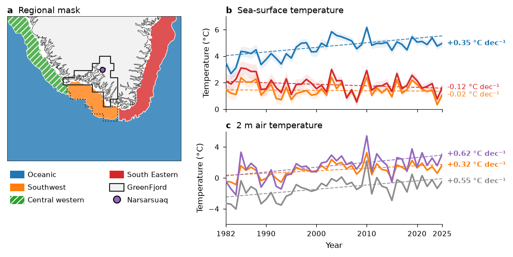

# Fig 2: Regional SST and 2 m air-temperature trends, 1982–2025



Three panels: **(a)** the regional mask, **(b)** annual sea-surface temperature
(SST) for three ocean regions, **(c)** annual 2 m air temperature for two ERA5
regions and the Narsarsuaq airport station.

## Why this figure

It answers how fast the ocean and the air around the GreenFjord domain have
warmed since 1982. Numbers below are the Theil–Sen slopes from the current
output (Mann–Kendall p-value in brackets):

- **Air is warming everywhere.** ERA5 GreenFjord +0.55 °C dec⁻¹ (p < 0.001),
  ERA5 Southwest +0.32 °C dec⁻¹ (p = 0.002), Narsarsuaq station
  +0.62 °C dec⁻¹ (p < 0.001).
- **The ocean signal depends on the region.** The off-shelf Oceanic region
  warms by +0.35 °C dec⁻¹ (p < 0.001). The shelf regions show no significant
  trend: Southwest −0.02 °C dec⁻¹ (p = 0.67), South Eastern −0.12 °C dec⁻¹
  (p = 0.06).

## How to read it

- **(a)** Ocean regions of the mask: Oceanic (blue), Southwest (orange),
  Central western (green, hatched), South Eastern (red). The black outline is
  the GreenFjord land area, the dotted line the GreenFjord ocean area, and the
  purple dot the Narsarsuaq station. Colours match the lines in (b) and (c).
  The Central western region is only drawn on the map; it has no SST line.
- **(b, c)** Solid lines are annual means, dashed lines Theil–Sen trends. The
  label at the right edge is the slope in °C per decade, in bold where the
  trend is significant (p < `analysis.alpha`, 0.05). Shading in (b) is half the
  DMI OI `analysis_error`. In (c), grey is ERA5 over the GreenFjord area,
  orange ERA5 over the Southwest ocean and purple the station.

`geenland_map.pptx` in this folder is a PowerPoint map of Greenland kept alongside
the figure. The script does not use it.

## Data

| Input (`config_SST_T2m_TRENDS.yaml` → `inputs`) | Contents | Source |
|---|---|---|
| `sst_monthly`: `../../data/sst_dmioi_monthly/sst_dmioi_monthly.zarr` | Monthly `analysed_st` and `analysis_error` (K), days with sea-ice fraction ≥ 0.05 masked, 1982–2025, 0.05° grid | DMI OI Arctic L4 reprocessed via CMEMS (S4) |
| `region_mask`: `../../data/ocean_regions_mask/ocean_regions_mask.nc` | Ocean region classes 1–4 | GEBCO 2023 bathymetry + distance to coast (S7) |
| `era5_monthly`: `../../data/era5_monthly_south_greenland/era5_monthly_south_greenland.nc` | Monthly ERA5 `t2m` (K) | ECMWF / C3S ERA5 (S6) |
| `land_ocean_ice`: `../../data/greenfjord_land_ocean_ice/greenfjord_land_ocean_ice.gpkg` | Land (1), ocean (2) and ice (3) polygons | Internal (S8) |
| `station_csv`: `../../data/dmi_metobs_narsarsuaq/dmi_metobs_narsarsuaq.csv` | Hourly (3-hourly earlier) `mean_air_temp` (°C), station 04270, raw | DMI metObs open data (S32) |

See [`DATA_SOURCES.md`](../../DATA_SOURCES.md) for the full citations (S4, S6, S7,
S8, S32).

## Methods

Implementation: `plot_SST_T2m_TRENDS.py`.

1. **SST regions.** The region mask is interpolated (nearest neighbour) onto the
   SST grid and the monthly `analysed_st` is averaged over each region
   (`load_sst_series`). Values are converted from K to °C. The uncertainty band is
   `analysis_error / 2`.
2. **ERA5 regions.** The polygons are rasterised onto the ERA5 grid and monthly
   `t2m` is averaged over each region (`load_era5_annual`).
3. **Annual means.** SST: mean of the monthly values per calendar year. ERA5 and
   station: means weighted by the days in each month.
4. **Station.** Hourly values are averaged to daily, then monthly, then annual
   (`load_station_annual`).
5. **Trend.** Theil–Sen slope (Sen, 1968) and Mann–Kendall significance
   (Mann, 1945; Kendall, 1975) on the trend-free prewhitened series (Yue et al.,
   2002), from `greenfjord.analysis.trends.theilsen_mannkendall_tfpw`. Slopes are
   scaled to °C per `trend_unit_per_years` (10) years.
6. **Shelf refit.** The Southwest and South Eastern SST trends are refitted from
   `analysis.shelf_refit.start_year` (1982). With the current settings this is
   identical to the full-period fit.

## Caveats

- **Station data are raw.** The DMI record is not quality controlled, and it
  changes from 3-hourly to hourly sampling, which can bias daily means slightly.
- **ERA5 is a reanalysis**, not an observation. The regional means are area
  means over polygons, not point values.
- **SST is ice-masked.** Pixel-days with sea ice are dropped, so the sampled area
  varies between months and years, mainly in the shelf regions.
- **TFPW is not conservative** for short autocorrelated series (Bayazit & Önöz,
  2007), and the three lines in (b) and (c) are not independent.
- **Trends depend on the period** (see Fig S SST trend periods).
- The ice-sheet ERA5 region and the bar plot version of this figure are no longer
  part of the folder (see `archive/`, not in git).
- No cache is used.

## Run

From the repository root:

```bash
MPLCONFIGDIR="$TMPDIR/mpl" .venv/bin/python fig2-sst_t2m_trends/plot_SST_T2m_TRENDS.py
```

All settings live in `config_SST_T2m_TRENDS.yaml`. Outputs:
`fig_SST_T2m_TRENDS.<fmt>` for each of `output.formats` (png and pdf). Only the
PNG is transparent (`output.transparent_png`). Switches that change the result:
`analysis.start_year` / `end_year`, `analysis.station`, the region lists and
`plot.lines.*.ylim`.

## References

- Bayazit, M. & Önöz, B. (2007) To prewhiten or not to prewhiten in trend
  analysis? *Hydrol. Sci. J.* 52, 611–624.
- Hersbach, H. et al. (2020) The ERA5 global reanalysis. *Q. J. R. Meteorol.
  Soc.* 146, 1999–2049, doi:10.1002/qj.3803.
- Kendall, M. G. (1975) *Rank Correlation Methods*. Charles Griffin, London.
- Mann, H. B. (1945) Nonparametric tests against trend. *Econometrica* 13,
  245–259.
- Nielsen-Englyst, P. et al. (2023) *Remote Sens. Environ.* 284, 113331,
  doi:10.1016/j.rse.2022.113331.
- Sen, P. K. (1968) Estimates of the regression coefficient based on Kendall's
  tau. *J. Am. Stat. Assoc.* 63, 1379–1389.
- Yue, S., Pilon, P., Phinney, B. & Cavadias, G. (2002) The influence of
  autocorrelation on the ability to detect trend in hydrological series.
  *Hydrol. Process.* 16, 1807–1829.

Part of the GreenFjord overview-figures set.
