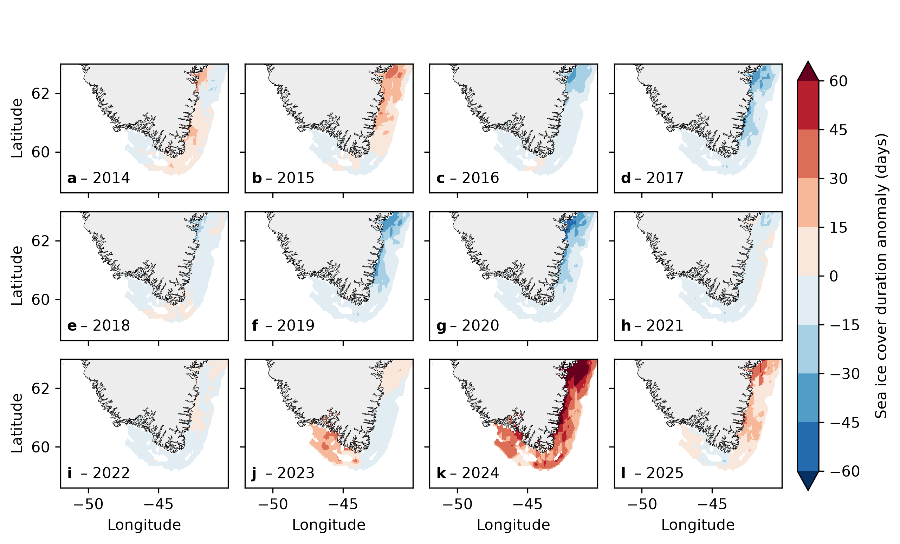

# Fig 3: Sea-ice cover duration anomaly

Annual anomaly of the number of sea-ice days per year around southern
Greenland (58.6-63 deg N, 52-40 deg W), one map per year, 2014-2025.



## Why this figure

It shows how the length of the sea-ice season off South Greenland changed from
year to year, and which years and areas stand out. The main take-away is that
2014-2022 are mostly within about +-30 days of the 2014-2025 mean, with
shorter-than-average ice cover along the east coast in 2016, 2017, 2019 and
2020. 2023 and 2024 stand out with longer ice cover, especially 2024, when
the anomaly reaches +91 days in the north-east (the colour scale saturates at
+60 days). In 2025 the anomaly is positive again along the east coast.
Across all years and cells the anomaly ranges from -61 to +91 days.

## How to read it

- Each panel (a-l) is one calendar year; the colour is the anomaly in days
  of ice cover relative to the mean of all plotted years (2014-2025), per
  grid cell. Red means more ice days than average, blue fewer.
- The colour scale has 11 levels from -60 to +60 days (step 15) and arrows
  show values beyond that range.
- White ocean cells are masked out: cells with `mask_min_days` (50) or fewer
  ice-covered days over `mask_period` are not shown. In the full file 4035
  cells are kept; the grey fill is land.

## Data

| Input (`config_DRIFT_ICE_ANOMS.yaml` -> `inputs`) | Contents | Source |
|---|---|---|
| `sea_ice_daily`: `../../data/sea_ice_dmioi_daily/sea_ice_dmioi_daily.nc` | Daily `sea_ice_fraction` (0-1), 1982-2025, 58.5-63.1 deg N, 52.075-39.925 deg W, 0.05 deg grid | DMI Arctic Ocean Sea and Ice Surface Temperature L4 REPROCESSED, CMEMS product `SEAICE_ARC_PHY_CLIMATE_L4_MY_011_016`, dataset `cmems_obs_si_arc_phy_my_L4-DMIOI_P1D-m`, doi:10.48670/moi-00123 |

The dataset is described in [`../../data/sea_ice_dmioi_daily/README.md`](../../data/sea_ice_dmioi_daily/README.md)
and cited in [`DATA_SOURCES.md`](../../DATA_SOURCES.md) (S4). Acknowledge the
E.U. Copernicus Marine Service as the distributor. Confirm the preferred
citation text on the product page.

## Methods

Implementation: `plot_DRIFT_ICE_ANOMS.py` (`load_ice_anomaly`, `plot_anomaly_maps`).

1. A day is ice-covered when `sea_ice_fraction > ice_threshold` (0.05).
2. The mask keeps cells with more than `mask_min_days` (50) ice-covered days
   between `mask_period` (2012-12-31 to 2025-12-31).
3. Ice-covered days are summed per calendar year for `anomaly_years`
   (2014-2025).
4. The anomaly is each year minus the mean over those years, per cell, and
   the mask is applied.
5. The panels are filled contours (`geo.plot_map_subplots`) cut to the plot
   extent, with a shared colour bar.

## Caveats

- The anomaly is relative to a short 12-year mean (2014-2025), not a climatology,
  so it depends on which years are included. The mask period is longer
  (2012-12-31 to 2025-12-31) than the anomaly period.
- The DMI OI product is an analysis of sea-ice fraction, not a dedicated
  sea-ice product, and has ~0.05 deg resolution, which limits fjord detail.
- The colour scale saturates at +-60 days; the 2024 maximum (+91 days) is not
  distinguishable from +60.
- The old versions of this figure that used the Met Office OSTIA and the DMI
  ARC MYNRT products have been dropped; only DMIOI is supported.

## Run

From the repository root:

```bash
MPLCONFIGDIR="$TMPDIR/mpl" .venv/bin/python fig3-drift_ice_anom/plot_DRIFT_ICE_ANOMS.py
```

Settings live in `config_DRIFT_ICE_ANOMS.yaml`. Output:
`fig_DRIFT_ICE_ANOMS.png` (`output.formats`, `output.dpi`). Switches that
matter: `analysis.anomaly_years`, `analysis.mask_period`,
`analysis.ice_threshold`, `analysis.mask_min_days`. There is no cache.

## References

- Nielsen-Englyst, P. et al. (2023) Remote Sens. Environ. 284, 113331,
  doi:10.1016/j.rse.2022.113331.
- DMI / E.U. Copernicus Marine Service, product
  `SEAICE_ARC_PHY_CLIMATE_L4_MY_011_016`, doi:10.48670/moi-00123.

Part of the GreenFjord overview-figures set.
