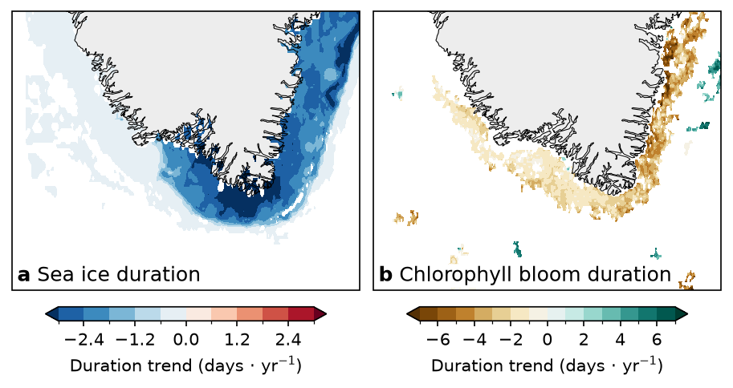

# Fig 4 — Sea-ice and chlorophyll bloom duration trends



Two-panel map of long-term change around southern Greenland (about 58–63°N,
52–40°W): **(a)** the trend in the annual sea-ice season duration and **(b)** the
trend in chlorophyll bloom duration, both in days per year.

## Why this figure

Does the open-water season get longer, and does the phytoplankton bloom follow?
Panel (a) shows where the ice season is shortening, panel (b) where the bloom is
becoming shorter or longer, so the two can be compared spatially.

With the current settings (checked against the output):

- **Sea ice (a):** all 8332 pixels with a significant trend (Mann–Kendall,
  p < 0.05) are negative. The slopes run from −4.75 to 0 days yr⁻¹, with a mean
  of −1.36 days yr⁻¹. The shortening is strongest in the inner shelf and along
  the east coast, where 768 pixels are below the −3 days yr⁻¹ colour limit.
- **Bloom (b):** the trend maps are mostly negative (shorter blooms) along the
  east coast and southwest shelf, with small positive patches offshore. The
  input spans −12.0 to +9.2 days yr⁻¹.

## How to read it

Both panels are filled-contour maps (Mercator) with land in grey and the same
map extent. Colours are the per-pixel trend in days yr⁻¹ on a scale centred on
zero.

- **(a)** blue = shorter ice season, red = longer. The colour scale is fixed to
  ±3 days yr⁻¹ (`plot.panels.a.vlim`), with arrows marking values beyond it.
  Only slopes significant at `analysis.alpha` are drawn; everything else is white.
- **(b)** brown = shorter bloom, green = longer, on a robust scale (2nd–98th
  percentile). Isolated patches smaller than `analysis.min_chl_patch_pixels`
  connected pixels are masked to suppress speckle.

## Data

| Input (`config_ICE_CHL_SEAS_DURATION.yaml` → `inputs`) | Contents | Source |
|---|---|---|
| `sea_ice_daily`: `../../data/sea_ice_dmioi_daily/sea_ice_dmioi_daily.nc` | Daily `sea_ice_fraction` (0–1), 1982-01-01 to 2025-12-31, 58.5–63.1°N, 52.075–39.925°W, 0.05° grid | DMI OI Arctic L4 reprocessed (CMEMS `cmems_obs_si_arc_phy_my_L4-DMIOI_P1D-m`), S4 in [`DATA_SOURCES.md`](../../DATA_SOURCES.md); see [`data/sea_ice_dmioi_daily/README.md`](../../data/sea_ice_dmioi_daily/README.md) |
| `chl_bloom_trend`: `data/chlorophyll_bloom_duration_trend.nc` | Bloom `duration` trend (days yr⁻¹) on `lat`/`lon`, 0.04° grid, about 58.0–63.0°N, 52.0–40.0°W | Nicholson et al. phenology of OC-CCI v6.0 chlorophyll-*a* (4 km), Zenodo 8402932, S9 in [`DATA_SOURCES.md`](../../DATA_SOURCES.md) |

The bloom file holds the finished trend only: it has no time axis and no
attributes, so its period (1997–2022, as stated in the earlier README and the
dataset's ESSD paper) cannot be checked from the file. How it was derived
from the Zenodo data is in
[`archive/examples/chl_phenology_nicholson.py`](archive/examples/chl_phenology_nicholson.py)
(download and bbox subset) and the original notebook
`archive/examples/figure4.ipynb`.

## Methods

Implementation: `plot_ICE_CHL_SEAS_DURATION.py`, using `greenfjord.analysis.phenology`
and `greenfjord.analysis.trends`.

1. **Select pixels.** Keep the years `start_year`–`end_year`. Pixels with at
   most `min_ice_days` ice days in total are dropped (`flat.where`), and zero
   fractions are set to missing.
2. **Ice season.** A day is ice-covered above `ice_threshold`. For each year the
   season is the persistent ice cover, i.e. ice lasting at least `min_gap` days:
   `phenology.get_phenology_stats`. This gives season start, end, count and
   `season_duration`.
3. **Trend.** Theil–Sen slope with a Mann–Kendall test of `season_duration`
   against year: `trends.theilsen_mannkendall`.
4. **Mask.** Keep slopes with p < `alpha` (`trends.get_significant_slope`), and
   only pixels with an ice season in more than `min_season_years` years.
5. **Panel (b).** Read the finished trend, then mask connected patches below
   `min_chl_patch_pixels` pixels (`scipy.ndimage.label`).

Steps 1–4 are slow (about 25 s) and cached in `cache/`, e.g.
`sea_ice_duration_trend-1982_2025-thr0.02-gap60-mindays2-minyears5-alpha0.05.nc`.
The filename encodes every analysis setting. **Delete the cache after changing
the `sea_ice_daily` input path**, since the path is not in the name.

## Caveats

- **Different periods.** Panel (a) covers 1982–2025 and panel (b) 1997–2022, so
  the two trends are not over the same years.
- **Different grids and products.** Sea ice is DMI OI (0.05°, interpolated
  analysis); the bloom trend is from 4 km ocean colour, which has gaps from
  cloud and polar night.
- **Ice season definition.** Results depend on `ice_threshold` and `min_gap`;
  the ice season is the persistent cover, so brief ice events do not count.
- **Colour scale clipping.** Panel (a) is clipped at ±3 days yr⁻¹; 768 pixels
  are beyond it.
- **No multiple-testing correction** on the per-pixel significance.
- Earlier versions of panel (a) (a pre-computed trend file and OSTIA-based
  recomputations) are kept in `archive/` for reference.

## Run

From the repository root:

```bash
MPLCONFIGDIR="$TMPDIR/mpl" .venv/bin/python fig4-ice_chla_phenology/plot_ICE_CHL_SEAS_DURATION.py
```

All settings live in `config_ICE_CHL_SEAS_DURATION.yaml`. Outputs:
`fig_ICE_CHL_SEAS_DURATION.<fmt>` for each of `output.formats` (png and pdf), at
`output.dpi` (300), with a transparent background (`plot.transparent`).

## References

- Mann, H. B. (1945) Nonparametric tests against trend. *Econometrica* 13, 245–259.
- Nicholson, S., Ryan-Keogh, T., Thomalla, S., Chang, N. & Smith, M. (2023)
  *Global Phytoplankton Phenological Indices – 4 km resolution* (v1.0). Zenodo,
  doi:10.5281/zenodo.8402932.
- Nicholson, S. et al. (2025) *Earth Syst. Sci. Data* 17, 1959–1975,
  doi:10.5194/essd-17-1959-2025.
- Nielsen-Englyst, P. et al. (2023) *Remote Sens. Environ.* 284, 113331,
  doi:10.1016/j.rse.2022.113331.
- Sen, P. K. (1968) Estimates of the regression coefficient based on Kendall's
  tau. *J. Am. Stat. Assoc.* 63, 1379–1389.

Part of the GreenFjord overview-figures set.
