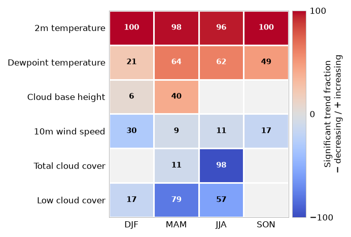

# Significant ERA5 trends across the GreenFjord land area



Heat map of the **net signed fraction of ERA5 grid cells with a statistically
significant seasonal trend** over the GreenFjord land area (southern
Greenland), 1982-2025. Rows are ERA5 variables and columns are seasons.

## Why this figure

A single regional trend line (Fig 2c) hides how widespread a trend is. This
figure asks: *in how much of the land area, and in which direction, do the
atmospheric variables change?* Main take-aways (1982-2025, 47 pixels):

- 2 m temperature rises almost everywhere in every season (96 to 100 % of
  pixels).
- Dewpoint temperature rises widely in MAM, JJA and SON (49 to 64 %).
- Cloud cover falls, most strongly in JJA for total cloud cover (-98 %) and
  in MAM and JJA for low cloud cover (-79 % and -57 %).
- 10 m wind speed shows weak net decreases, strongest in DJF (-30 %).

The numbers are in `data_ERA_TREND_SIG-net_fraction.csv`.

## How to read it

- **Cell value:** `100 x (share of pixels with a significant increasing trend
  - share with a significant decreasing trend)`, in %. The printed number is
  the absolute value; the colour gives the sign.
- **Colour:** diverging `coolwarm` scale from -100 % (blue, net decreasing) to
  +100 % (red, net increasing). 0 % is grey-white.
- **Empty cells:** net fraction below 5 % in absolute value (`plot.hide_below_abs`).
  They are drawn in the background colour and carry no number.
- **Row order:** variables sorted from the most positive to the most negative
  mean net fraction across seasons.
- A net fraction of 0 can mean "no significant trend" or "equal numbers of
  increasing and decreasing pixels"; the figure does not distinguish them.

## Data

| Input | Contents | Units | Coverage |
|---|---|---|---|
| `../../data/era5_monthly_south_greenland/era5_monthly_south_greenland.nc` | ERA5 monthly means: `t2m`, `d2m`, `tcc`, `lcc`, `cbh`, `si10` are used (`msl` is also in the file) | K, K, 1, 1, m, m s-1 | 1982-01 to 2025-12, 55-70 N, 80-30 W, 0.25 deg |
| `../../data/greenfjord_land_ocean_ice/greenfjord_land_ocean_ice.gpkg` | Region polygons; the `land` polygon defines the pixels | EPSG:4326 | 48.125-43.875 W, 59.375-61.875 N |

Sources: ERA5 (Hersbach et al. 2020; S6 in [`DATA_SOURCES.md`](../../DATA_SOURCES.md))
and the GreenFjord land polygon (S8, internal). Both are described in their
dataset folders. Neither file is in git (`*.nc` and `*.gpkg` are ignored): get
the ERA5 file with `data/era5_monthly_south_greenland/download_era5_monthly_south_greenland.py`
(needs a CDS account); the polygon file has no regeneration script and must be
copied from the project's shared data.

## Methods

All steps are in `plot_ERA_TREND_SIG.py`, function `load_net_fraction()`.

1. Open the ERA5 file and crop it to the bounding box of the region polygons.
2. **Pixel selection:** keep the grid cells whose *centre* lies inside the
   `land` polygon (`shapely.contains_xy`). This gives 47 pixels. (The
   `.rv.to_raster` rasterisation used in Fig S t2m selects 49, so the pixel
   sets of the two figures differ slightly.)
3. Clip the time axis to `start_year`..`end_year`, then average to seasons with
   `resample("QS-DEC")` and `seasonal_trends.preprocess_data`. DJF is labelled
   by its December year.
4. Per pixel and season, compute the Theil-Sen slope and the Mann-Kendall
   p-value over the annual series (`trends.theilsen_mannkendall`).
5. A trend is significant when `p < analysis.alpha` (0.05). Take the share of
   valid pixels with a significant positive slope and with a significant
   negative slope, and subtract: net fraction.
6. Draw the heat map (`plot_net_fraction_heatmap`).

All settings (period, region, variables and their labels, `alpha`, colours,
layout, output) are in `config_ERA_TREND_SIG.yaml`.

## Caveats

- **The last DJF is one month.** The time axis is clipped at `end_year`-12
  before the seasonal means, so the DJF of `end_year` is December of that year
  only. This is how the original analysis was done and is kept so the DJF
  column reproduces it. Complete-season handling (as in Fig S t2m) would change
  some DJF cells slightly (not 2 m temperature).
- **No allowance for autocorrelation or multiple testing.** The plain
  Mann-Kendall test is used (no prewhitening), and neighbouring ERA5 pixels are
  not independent. The fractions describe how widespread significant trends
  are; they are not a field-significance test.
- 47 pixels at 0.25 deg is a small domain, so one pixel is about 2 percentage
  points.
- Cloud variables (`tcc`, `lcc`, `cbh`) are model products and less
  constrained by observations than temperature.
- No cache is used; the analysis takes seconds. Nothing needs deleting after
  changing settings.
- Moving from 1982-2021 (the earlier version of this figure) to 1982-2025
  changes the values. For 1982-2021 the script reproduces the earlier CSV to
  floating-point precision.

## Run

From the repository root:

```
MPLCONFIGDIR="$TMPDIR/mpl" .venv/bin/python fig5-era5_pixel_frac/plot_ERA_TREND_SIG.py
```

Outputs, written to this folder:

- `fig_ERA_TREND_SIG.png` (formats from `output.formats`, `output.dpi`)
- `data_ERA_TREND_SIG-net_fraction.csv`: plotted values, variable x season, %

Useful switches: `analysis.start_year` / `end_year` (period), `analysis.region`
(`land`, `ocean` or `ice`), `analysis.variables` (which ERA5 variables, with
labels), `output.save_csv`.

`archive/` holds the earlier seasons-on-Y layout script and the superseded
per-variable bar plot.

## References

- Hersbach, H. et al. (2020). The ERA5 global reanalysis. *Q. J. R. Meteorol.
  Soc.* 146, 1999-2049. doi:10.1002/qj.3803
- Sen, P. K. (1968). Estimates of the regression coefficient based on Kendall's
  tau. *J. Am. Stat. Assoc.* 63, 1379-1389.
- Mann, H. B. (1945). Nonparametric tests against trend. *Econometrica* 13,
  245-259. Kendall, M. G. (1975). *Rank Correlation Methods*. Griffin.
