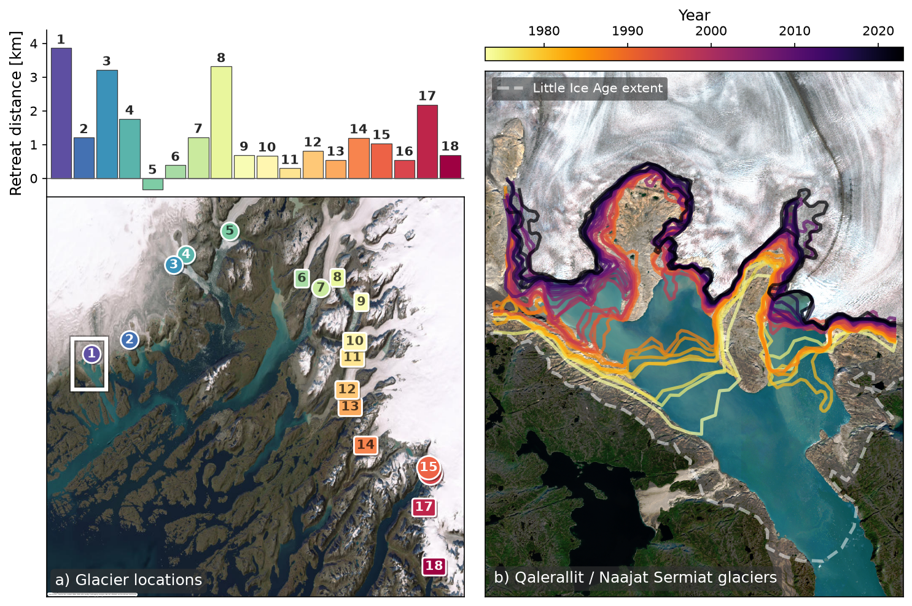

# Glacier retreat, Qalerallit / Naajat Sermiat (South Greenland)

Two-panel figure of glacier-front retreat around the Qalerallit / Naajat Sermiat
glacier system (about 61.0 N, 46.7 W): (a) total front retreat of 18 glaciers
as bars above a satellite map of their outlines, (b) year-coloured front
outlines of one glacier over a Sentinel-2 scene.



## Why this figure

It shows how far the marine- and land-terminating glaciers in the area have
retreated since 1992 and how the terminus of Qalerallit / Naajat Sermiat moved
since 1973. Bar values (1992 to 2024): 17 of the 18 glaciers retreated, by 0.3
to 3.9 km; glacier 1 (3.9 km), 8 (3.3 km) and 3 (3.2 km) retreated most, and
glacier 5 shows a net advance of 0.3 km. Panel (b) shows the fronts
withdrawing from the Little Ice Age extent (dashed line) to the dark, most
recent fronts (2023).

## How to read it

- **Panel (a), bars:** total front retreat per glacier (km, last minus first
  value of the 1992 to 2024 record; positive = retreat, negative = advance).
  The number above each bar is the glacier number and also its colour
  (`Spectral_r`, 1 = purple to 18 = red).
- **Panel (a), map:** latest outline of each glacier over Esri World Imagery,
  marked by its number (circle = marine-terminating, rounded box otherwise).
  The white box marks the extent of panel (b), around glacier 1.
- **Panel (b):** one terminus line per year, 1973 to 2023, coloured with
  `inferno_r` (light = oldest, dark = most recent; colour bar above the panel),
  over a true-colour Sentinel-2 scene (August 2024). The dashed white line is
  the Little Ice Age extent.

## Data

All vector data are in EPSG:32623 (UTM zone 23N) unless noted. Paths are
relative to this folder (`inputs:` in `config_GLACIER_RETREAT.yaml`); the data
are only used by this figure, so they live in `data/` here.

| Input (`inputs`) | Contents | Units / coverage |
|---|---|---|
| `retreat_csv`: `data/glacier_retreat.csv` | cumulative front retreat per glacier (`glacier_00` to `glacier_18`), 1992 baseline | km, 1992-2024 |
| `outlines_gpkg`: `data/glacier_outline-rectangles.gpkg` | 309 near-rectangular glacier outlines, ids 0-18, one per glacier and year | polygons |
| `lia_gpkg`: `data/LIAextenthistorical.gpkg` | Little Ice Age maximum-extent line | EPSG:4326 |
| `fronts_old_shp`: `data/glacier_i16n6104w4669/..._handdrawn_v2.shp` | hand-drawn front polygons for 1973, 1981, 1985 | polygons |
| `fronts_new_gpkg`: `data/glacier_i16n6104w4669/..._poly-manually_adjusted.gpkg` | traced and manually adjusted front polygons | 1992-2024 |
| `sentinel2_tif`: `data/glacier_i16n6104w4669/..._sentinel2-truecolor-2024-08.tif` | true-colour Sentinel-2 median scene, reflectance 0-1 | 10 m, August 2024 |

Other files in `data/` are not read by the figure and are kept for reference:
`glacier_area_cover.csv` (glacier area per year, km2, 1992-2024),
`glacier_i16n6104w4669/` `..._handdrawn.gpkg` (v1 hand-drawn fronts),
`..._poly.gpkg` (traced fronts before manual QC), `..._water.gpkg` (water
mask), `..._data.nc` and `..._data_elev.nc` (source raster cube and elevation
used for the tracing, glacier id 16, centre 61.04 N, 46.69 W),
`..._figures.pdf` (tracing diagnostics) and `rasters/` (per-year false-colour
scenes used to trace the fronts).

The figure numbers (1-18) are a renumbering of the source ids (`exclude_ids`
drops id 18, `reverse_labels` makes number 1 the highest id); the glacier of
panel (b) is source id 16 (`i16n6104w4669`), number 2 in the figure. Sources (see [`DATA_SOURCES.md`](../../DATA_SOURCES.md)):

- **Imagery for tracing:** Landsat Collection-2 Level-1 (`landsat-c2-l1`) via
  the Microsoft Planetary Computer, USGS/NASA Landsat program. Annual scenes
  from 1992, plus 1973, 1981 and 1985.
- **Panel (b) backdrop:** Sentinel-2 L2A (`sentinel-2-l2a`, Copernicus/ESA,
  Planetary Computer), built by `data/glacier_i16n6104w4669/download_sentinel2.py`.
- **Panel (a) tiles:** Esri World Imagery through contextily.
- **Fronts, outlines, retreat and area tables:** GreenFjord glacier-tracing
  products (automated pipeline plus manual adjustment; hand-drawn for the
  oldest years). The files carry no product name, DOI or author in their
  metadata: confirm the citation with the data provider before publication.
- **Little Ice Age extent:** origin not recorded in the file; confirm the
  source with the data provider.

## Methods

Implementation: `plot_GLACIER_RETREAT.py`.

1. `load_retreat`: total retreat per glacier is the last minus the first valid
   value of its cumulative record, in `retreat_unit`; ids in `exclude_ids` are
   dropped, the rest numbered and coloured from `glacier_cmap`.
2. `load_latest_outlines`: the latest outline per glacier, reprojected to
   EPSG:3857 for the web-tile basemap.
3. `load_fronts`: hand-drawn and traced polygons are combined and clipped to a
   shared rectangle; `drop_year` (2024) is removed and each polygon is reduced
   to its longest boundary segment longer than `min_front_length_m`.
4. `plot_retreat_bars` and `plot_outline_map` draw panel (a);
   `plot_front_outlines` draws panel (b) over `load_sentinel2`.
   The northern `clip_north_frac` of panel (b) is cut so its colour bar lines up
   with the top of the bar plot.

## Caveats

- The retreat is measured along each glacier's front from outlines traced in
  satellite imagery; the image resolution limits the accuracy of small changes
  such as the advance of glacier 5.
- Outlines from 1973 to 1985 are hand-drawn and 1992 to 2024 are traced and
  manually adjusted, so the two periods are not strictly homogeneous. The 2024
  front is dropped from panel (b) as a partial trace.
- The Sentinel-2 scene is from August 2024 and does not represent the older
  front positions.
- The map basemap needs network access (Esri tiles); the figure has no cache
  of its own. Delete the Sentinel-2 GeoTIFF to rebuild it with the download
  script.

## Run

From the repository root:

```bash
MPLCONFIGDIR="$TMPDIR/mpl" .venv/bin/python fig6-glacier_retreat/plot_GLACIER_RETREAT.py
```

Settings live in `config_GLACIER_RETREAT.yaml`. Output:
`fig_GLACIER_RETREAT.png` (`output.formats`, `output.dpi`). Switches that
matter: `analysis.retreat_unit`, `analysis.exclude_ids`,
`plot.panel_a.sort_bars_by`, `plot.panel_a.basemap_provider`. To rebuild the
Sentinel-2 scene (needs network and `scikit-image`):

```bash
.venv/bin/python fig6-glacier_retreat/data/glacier_i16n6104w4669/download_sentinel2.py
```

Superseded scripts, notebooks, earlier figure versions and the work log are in
`archive/`.

## References

- Landsat Collection 2 (USGS/NASA) and Sentinel-2 L2A (Copernicus/ESA), both
  accessed through the Microsoft Planetary Computer.
- Esri World Imagery, tiles via contextily.

Part of the GreenFjord overview-figures set.
