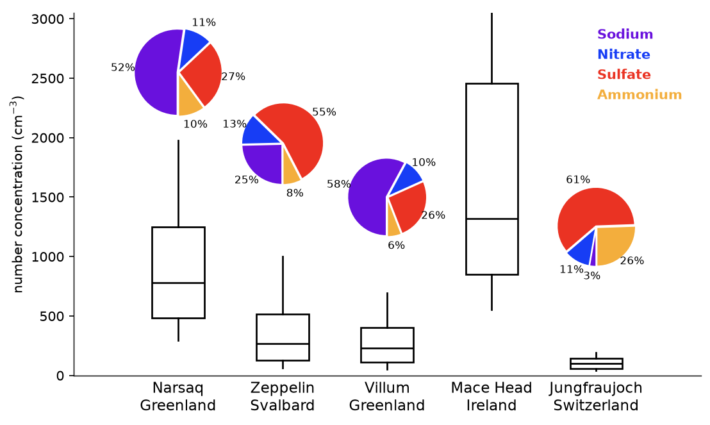
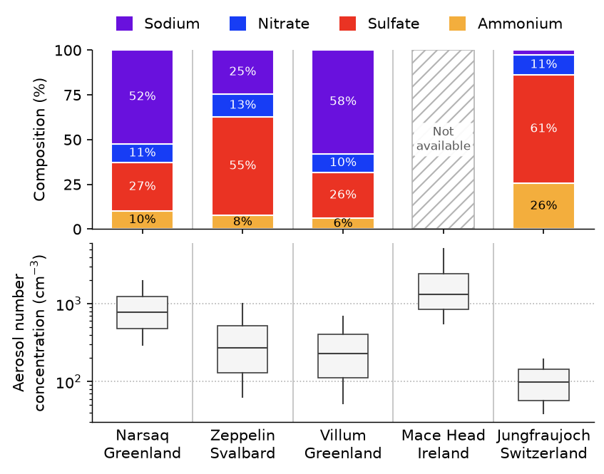

# Fig 7 — Aerosol number concentration and ion composition (Narsaq vs. background stations)



This folder holds **two variants** of the same figure. Both are kept until the
authors choose one; this is a deliberate exception to the "one script per
folder" rule.

| Variant | Script / config | Output |
|---|---|---|
| Box plots with pie charts overlaid (matches the original reference, `archive/boxplot-piecharts.png`) | `plot_AEROSOL_CONC.py`, `config_AEROSOL_CONC.yaml` | `fig_AEROSOL_CONC.png/.pdf` |
| Two panels: stacked-bar composition on top, log-scale box plots below | `plot_AEROSOL_CONC_STACKED.py`, `config_AEROSOL_CONC_STACKED.yaml` | `fig_AEROSOL_CONC_STACKED.png/.pdf` |



## Why this figure

It places the Narsaq (south Greenland) 2023 summer campaign in context: how
many aerosol particles were there, and what were they made of, compared with
established background stations (Zeppelin, Villum, Mace Head, Jungfraujoch)?
Narsaq has a median number concentration of roughly 800 cm⁻³, well above
Zeppelin, Villum and Jungfraujoch and below Mace Head. Its PM10 ion
composition is dominated by sodium (52 %), where sulfate dominates at Zeppelin
and Jungfraujoch. The station periods differ, so the comparison is
approximate.

## How to read it

- **Boxes:** number concentration of particles of 10–710 nm, July/August.
  Box = interquartile range, bar = median, whiskers = 10th and 90th percentiles.
  No outliers are drawn. The pie variant uses a linear axis; the stacked variant
  a log axis.
- **Composition:** fractional contribution of four ions to PM10, normalised to
  100 % per station. Colours carry meaning in the community and are sampled from
  the original figure: sodium purple, nitrate blue, sulfate red, ammonium orange.
  Slices of 5 % or less are not labelled in the stacked variant.
- **Mace Head** has no composition data (pie variant: no pie; stacked variant:
  hatched "Not available" bar).
- **Periods:** number concentration: Narsaq 2023, Zeppelin 2010–2020, Villum
  2010–2017, Mace Head 2011–2012, Jungfraujoch 2012–2014. Composition: Narsaq
  2023, Zeppelin 1993–2019, Villum 1990–2017, Jungfraujoch 2011–2021.
- The pie variant adds a small gap between slices (`plot.pie.explode`), which the
  original did not have.

## Data

Both files are tab-separated and live in `data/` (used by this figure only).

| Input (`inputs`) | Contents | Source |
|---|---|---|
| `box_stats`: `data/box-plots.txt` | Per-station particle-count percentiles in cm⁻³. `_25/_50/_75` = Q1/median/Q3; `_10EB`/`_90EB` = whisker lengths from the box edges to the 10th/90th percentiles | Narsaq: this study (Fidas Frog optical particle sizer). Others: Schmale et al. (2017) |
| `ion_fractions`: `data/Pie-charts.txt` | Ion fractions (rows `NA`/`NO3`/`SO4`/`NH4`; columns `Na_species_PM10` = Narsaq, `Zep_species`, `Vil_species`, `JFJ_species`). Fractions sum to about 1 | Narsaq: PM10 filter analysis, this study. Others: Schmale et al. (2022) |

See [`DATA_SOURCES.md`](../../DATA_SOURCES.md) (S16, S17, S18). The files carry no
embedded provenance; attribution comes from this README and DATA_SOURCES.md.

## Methods

1. **Box statistics** (`load_box_stats`): the whiskers are Q1 − `10EB` and
   Q3 + `90EB`, passed to `matplotlib.Axes.bxp` with fliers off.
2. **Composition** (`load_ion_fractions`): ion rows are renamed (NA → Sodium
   etc.), then each station's four fractions are renormalised to sum to 1
   (100 %). The label `NA` is read with `keep_default_na=False`, so it is not
   turned into NaN.
3. **Plot:** pies are inset axes placed in data coordinates above each box
   (`plot_composition_pies`); stacked bars are drawn by
   `plot_composition_bars`, and boxes by `plot_box_concentrations`.
4. **Style:** the old `figure.mplstyle` was moved into `plot.style` of each
   config. The only addition is `xtick/ytick.major.size: 3.5`, to cancel the
   shared paper style's 0, so the output is unchanged.

## Caveats

- The two variants must be kept consistent by hand: they share the same data
  and colours, but each has its own YAML.
- The station periods differ, and Narsaq is a single summer, so the comparison
  is approximate.
- The pie variant positions pies by hand (`plot.pie.positions`, in data
  coordinates); change the y limits and they need re-tuning.
- The pie variant prints a harmless `findfont: font weight 100` warning
  (`plot.xtick_fontweight`, kept from the original).

## Run

From the repository root:

```bash
MPLCONFIGDIR="$TMPDIR/mpl" .venv/bin/python figures/fig7_AEROSOL_CONC/plot_AEROSOL_CONC.py
MPLCONFIGDIR="$TMPDIR/mpl" .venv/bin/python figures/fig7_AEROSOL_CONC/plot_AEROSOL_CONC_STACKED.py
```

Outputs are `fig_AEROSOL_CONC.<fmt>` and `fig_AEROSOL_CONC_STACKED.<fmt>` for
each of `output.formats` (png and pdf), at `output.dpi` (300). All other
settings (colours, labels, layout, style) are in the two YAML files.
`archive/boxplot-piecharts.png` is the original reference image the pie variant
was recreated from.

## References

- Schmale, J., Henning, S., Henzing, B., et al. (2017) Collocated observations
  of cloud condensation nuclei, particle size distributions, and chemical
  composition. *Sci. Data* 4, 170003, doi:10.1038/sdata.2017.3.
- Schmale, J., Sharma, S., Decesari, S., et al. (2022) Pan-Arctic seasonal
  cycles and long-term trends of aerosol properties from 10 observatories.
  *Atmos. Chem. Phys.* 22, 3067–3096, doi:10.5194/acp-22-3067-2022.

Part of the GreenFjord overview-figures set.
