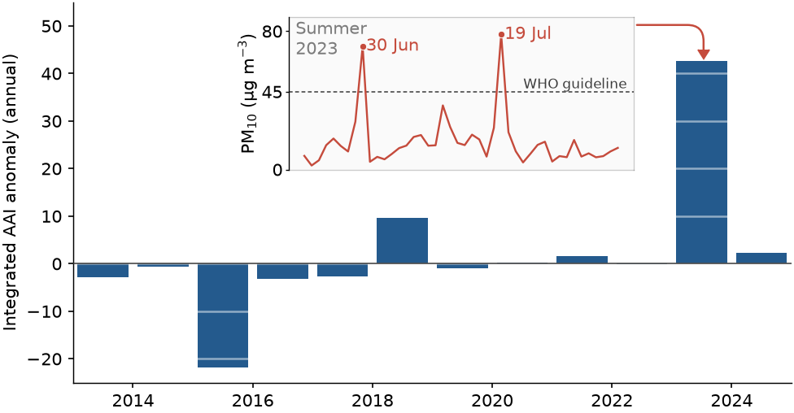

# Fig 8 — Absorbing aerosol index anomaly and summer-2023 PM10 at Narsaq



Annually integrated GOME-2B absorbing aerosol index (AAI) anomaly for the area
of Narsaq (2013–2024), with the summer-2023 Narsaq PM10 record as an inset.

## Why this figure

It puts the aerosol event measured at Narsaq in summer 2023 into a satellite
context. The 2023 bar is by far the largest positive anomaly of the 2013–2024
record (+42.7 against at most +9.7 in any other year; 2015 is the largest negative, −21.8), so the
PM10 peaks measured in the field fall in an exceptional aerosol year. Two days
in the PM10 record, 30 Jun and 19 Jul, exceed the WHO 45 µg m⁻³ guideline.

## How to read it

- **Bars:** the daily AAI anomaly summed over each calendar year, for the area
  of Narsaq. The anomaly is relative to the 2013–2024 mean. Positive values
  mean more UV-absorbing aerosol (smoke, dust) than average.
- **Inset (PM10):** daily PM10 mass concentration in Narsaq, summer 2023.
  The dashed line is the WHO guideline (`analysis.who_threshold_ugm3`, 45
  µg m⁻³). Days above it are marked with a dot and labelled with their date.
  The time axis is left without ticks on purpose, since only the peak dates matter.
- **Red marker and connector:** link the inset to the year it belongs to. The
  marker sits above the highest bar, at the midpoint of the PM10 record.

## Data

| Input (`config_AEROSOL_ANOM.yaml` → `inputs`) | Contents | Source |
|---|---|---|
| `pm10`: `data/PM10-concentrations.txt` | Narsaq summer-2023 daily PM10, tab-separated. `mastertime_1d` is LabVIEW time (seconds since 1904-01-01), so the first sample is 2023-06-21. `PM10_1d` is in µg m⁻³. | Measured in this study with a Fidas Frog optical particle sizer (assumed density 1.5 g cm⁻³) |
| `aai`: `data/greenfjord_timeseries_aai_anom_gome2b_2013_2024.csv` | Daily point estimates of the GOME-2B AAI anomaly for the Narsaq area, 2013–2024 (3368 rows; columns `time`, `absorbing_aerosol_index`) | ESA CCI GOME-2B AAI Level-3 daily product (see below) |

The AAI csv is produced from the ESA CCI GOME-2B netCDFs by `archive/aai.py`.
It is used by this figure only, so it stays in this folder's `data/` and not in
the shared root `data/`.

**AAI product.** GOME-2B (GOME-2 on MetOp-B) Absorbing Aerosol Index, Level-3
daily gridded product, version fv1.9 (files named
`ESACCI-AEROSOL-L3-AAI-GOME2B-1D-YYYYMMDD-fv1.9.nc`). Produced by KNMI under the
EUMETSAT AC SAF and distributed via TEMIS (www.temis.nl/airpollution/absaai/).
See [`DATA_SOURCES.md`](../../DATA_SOURCES.md).

## Methods

Implementation: `plot_AEROSOL_ANOM.py`.

1. `load_pm10`: convert LabVIEW seconds to timestamps (`analysis.labview_epoch`)
   and drop days without a PM10 value.
2. `load_aai_annual`: sum the daily AAI anomaly per calendar year.
3. `plot_aai_bars`: one bar per year, centred mid-year.
4. `plot_record_marker`: place the marker at the midpoint of the PM10 record
   (as a decimal year), above the highest bar, and draw the elbow connector to
   the inset.
5. `plot_pm10_inset`: plot the PM10 line, the WHO line, and mark and label the
   days above `who_threshold_ugm3`.

The shared paper style is applied first, then `plot.style` restores the style
this figure used before conversion (font sizes, spines, tick direction).

## Caveats

- The AAI is a qualitative indicator of absorbing aerosol, not a mass
  concentration. It is not directly comparable to PM10.
- The annual sum is of a daily anomaly, so it depends on how many days have a
  valid retrieval in each year.
- The PM10 record covers one summer only, and the estimate assumes a particle
  density of 1.5 g cm⁻³.
- The red marker is placed at the PM10 record midpoint, which is in 2023.

## Run

From the repository root:

```bash
MPLCONFIGDIR="$TMPDIR/mpl" .venv/bin/python figures/fig8_AEROSOL_ANOM/plot_AEROSOL_ANOM.py
```

All settings live in `config_AEROSOL_ANOM.yaml`. Outputs are
`fig_AEROSOL_ANOM.<fmt>` for each of `output.formats` (png and pdf), at
`output.dpi`. Switches that matter: `analysis.who_threshold_ugm3` (which days are
highlighted), `plot.panels.inset.position` and `plot.panels.aai.ylim`.

`archive/` holds the AAI downloader (`aai.py`), the superseded two-panel script
(`plot_pm10_aai_old.py`) and the original reference figure (`concentrations.png`).

## References

- Tilstra, L. G., Tuinder, O. N. E. and Stammes, P. (2010) *GOME-2 Absorbing
  Aerosol Index: Statistical analysis, comparison to GOME-1 and impact of
  instrument degradation*. Proceedings of the 2010 EUMETSAT Meteorological
  Satellite Conference.
- de Graaf, M., Stammes, P., Torres, O. and Koelemeijer, R. B. A. (2005)
  Absorbing Aerosol Index: Sensitivity analysis, application to GOME and
  comparison with TOMS. *J. Geophys. Res.* 110, D01201,
  doi:10.1029/2004JD005178.

Part of the GreenFjord overview-figures set.
