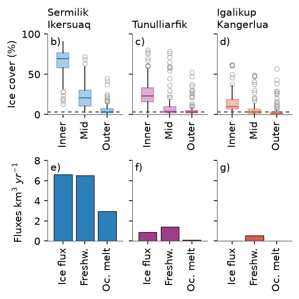

# Fig 9 — Fjord ice cover and annual fluxes



Sea-ice cover by fjord zone (top row) and annual ice and freshwater fluxes
(bottom row) for three southern Greenland fjord systems: Sermilik–Ikersuaq,
Tunulliarfik and Igalikup Kangerlua.

## Why this figure

It compares how much ice the fjords hold with how much ice and freshwater the
glaciers feed into them. Take-aways:

- **Ice cover falls from the fjord head to the mouth.** The median ice cover of
  Sermilik–Ikersuaq is 70 % in the Inner zone, 21 % in Mid and 3 % in Outer.
  Tunulliarfik is 23 %, 4 % and 3 %, and Igalikup Kangerlua 10 %, 3 % and 2 %.
  The mean coastal-ocean ice cover is 3.4 %.
- **Sermilik–Ikersuaq is by far the biggest source.** Its glaciers deliver
  6.6 km³ yr⁻¹ of ice and 6.5 km³ yr⁻¹ of freshwater, of which ocean melt is
  3.0 km³ yr⁻¹. Tunulliarfik gives 0.87, 1.4 and 0.13 km³ yr⁻¹, and Igalikup
  Kangerlua 0, 0.55 and 0 km³ yr⁻¹.

## How to read it

- **Columns** are fjords, in the same colours in both rows.
- **Top row (b–d):** boxplots of monthly sea-ice concentration (%, 2014-10 to
  2024-10) for the Inner, Mid and Outer zone of the fjord. Boxes show the
  quartiles, the line the median, whiskers the usual 1.5 x IQR range and open
  circles the outliers. The dashed grey line is the mean ice cover of the
  coastal ocean, shown for reference.
- **Bottom row (e–g):** three bars per fjord in km³ yr⁻¹: ice flux, annual
  freshwater flux and ocean melt. Each is summed over the glaciers of the fjord.
  Ocean melt is the ice flux times the tabulated ratio of ocean melt to ice flux.
- The y axes are shared along each row.

## Data

| Input (`config_FJORD_ICE_BARS.yaml` → `inputs`) | Contents | Source |
|---|---|---|
| `ice_cover`: `../../data/fjord_ice_regions_monthly/fjord_ice_regions_monthly.xlsx` | Sheet `seaice_conc`: monthly sea-ice concentration (%) per fjord and zone (Inner / Mid / Outer), plus a coastal-ocean series, 2014-10 to 2024-10. See [`data/fjord_ice_regions_monthly/README.md`](../../data/fjord_ice_regions_monthly/README.md). | Provider not recorded (SIGRID-3 ice charts, probably DMI); see source S20 in [`DATA_SOURCES.md`](../../DATA_SOURCES.md) |
| `fluxes`: `fluxes_overviewpaper_tabulated.csv` | Per-glacier table: ice flux `qice`, annual freshwater flux `qfwann`, ocean melt `qoceanmelt` (ratio to ice flux), plus columns not used here. Fluxes in km³ yr⁻¹. | The overview-paper tabulation. Provenance is not recorded; see S21 in [`DATA_SOURCES.md`](../../DATA_SOURCES.md) |

The workbook headers are used as they are, including the typos
`Sermelik - Ikersuaq` and `Tunuliarfik` and the trailing space in `Inner `.
They are set in `plot.panels` and `analysis.zones` in the config.

## Methods

Implementation: `plot_FJORD_ICE_BARS.py`.

1. `read_ice_cover()` reads the `seaice_conc` sheet and returns the monthly
   values per fjord and zone (missing months dropped), plus the mean of the
   coastal-ocean series.
2. `read_fluxes()` fills empty CSV cells with 0, computes ocean melt as ice flux
   times its ratio per glacier, and sums ice flux, freshwater flux and ocean
   melt by fjord.
3. `plot_ice_cover_boxplots()` and `plot_flux_bars()` draw the two rows.

## Caveats

- The provenance of both inputs is unrecorded (see Data), so the figure cannot
  yet be cited to a source.
- Glaciers with an empty ocean-melt ratio count as 0 melt (Igalikup Kangerlua).
- Fluxes are summed over the glaciers in the table; the uncertainty column is
  not shown.
- Only the `seaice_conc` sheet of the workbook is used, and about 113 of 121
  months per zone have a value.
- No cache or CSV export.

## Run

From the repository root:

```bash
MPLCONFIGDIR="$TMPDIR/mpl" .venv/bin/python figures/fig9_FJORD_ICE_BARS/plot_FJORD_ICE_BARS.py
```

Writes `fig_FJORD_ICE_BARS.png` (formats and dpi set under `output`). Figure
size, colours, axis ranges and labels are under `plot`.

`archive/` holds the reference screenshot the figure was first recreated from
(`Screenshot 2026-07-14 at 16.36.18.png`) and the unused raster fjord mask
`fjord_mask.nc`.

## References

None recorded; see [`DATA_SOURCES.md`](../../DATA_SOURCES.md).
