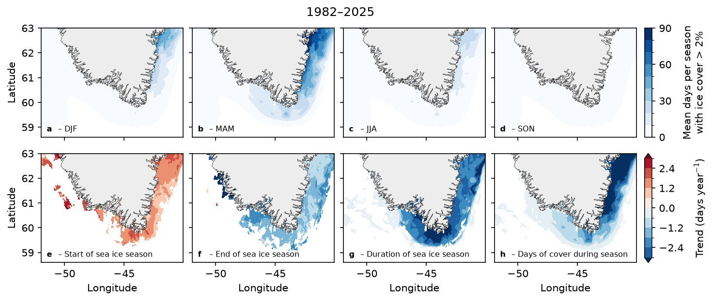

# Fig S — Sea-ice seasonality and phenology trends



Top row (a–d): mean number of days per season with sea ice. Bottom row (e–h):
significant trends in the start, end, duration and days of cover of the sea-ice
season. Region: southern Greenland, 58.6–63°N, 52–40°W; window 1982–2025.

## Why this figure

It shows when and where sea ice is present around southern Greenland, and how
the length and timing of the ice season have changed. The top row gives the
climatological ice cover by season. The bottom row shows where the season
starts later or earlier, ends later or earlier, and gets longer or shorter. The
trend maps are cropped to pixels with a season in more than `min_season_years`
years. With the current settings, significant trends cover 3615 (start), 4625
(end), 6079 (duration) and 6227 (days of cover) pixels. The largest absolute
trends are 3.6 (start), 8.8 (end), 4.8 (duration) and 4.5 (days of cover) days
per year, so the colour scale (±3 days per year) saturates in places.

## How to read it

- **Panels a–d** are DJF, MAM, JJA and SON (initial letters of the months).
  Colour is the mean days per season with sea-ice fraction above
  `analysis.ice_day_fraction` (Blues, 0–90 days). Cells that are ice-covered on
  at most `analysis.mask_min_days` days over the record are left blank.
- **Panels e–h** show the Theil-Sen slope in days per year (RdBu_r, ±3, open
  ends). Only slopes with a Mann-Kendall p-value below `analysis.alpha` are
  coloured. For the start, a positive trend means a later start (December dates
  are negative, so the start day-of-year is wrapped around the new year).
- Grey is land.

## Data

| Input | Content | Source |
|---|---|---|
| `../../data/sea_ice_dmioi_daily/sea_ice_dmioi_daily.nc` | Daily sea-ice fraction (0–1), 0.05° grid, 1982-01-01 to 2025-12-31, plot extent plus a 0.1° buffer | DMI OI Arctic L4 via CMEMS, source S4 in [`DATA_SOURCES.md`](../../DATA_SOURCES.md) |

See [`data/sea_ice_dmioi_daily/README.md`](../../data/sea_ice_dmioi_daily/README.md)
for how the file was made. The CMEMS download is not part of this figure.

## Methods

1. `load_daily` reads the daily sea-ice fraction.
2. `load_seasonal`: a day counts as ice-covered when the fraction exceeds
   `ice_day_fraction`. Days are counted per season (`time.season`) and divided
   by the number of years in the window. DJF uses December of one year with
   January–February of the next as they occur in the record, so December 1981
   is not included.
3. `load_phenology`: pixels with at most `min_ice_days` ice days are dropped.
   Per pixel and year, the sea-ice season is the persistent ice cover lasting at
   least `min_gap` days (`greenfjord.analysis.phenology.get_phenology_stats`),
   giving start, end, duration and count of ice days within the season. Years
   without a start or end have NaN there; duration and count are 0.
4. `load_trends`: a Theil-Sen slope and a Mann-Kendall test per pixel and
   variable (`greenfjord.analysis.trends`). With `trend_method: "tfpw"` the test
   uses the trend-free prewhitened series (Yue et al., 2002); the slope always
   comes from the original series. Years with NaN are left out. Pixels need a
   season in more than `min_season_years` years, and start / end trends also a
   valid date in more than `min_date_years` years.
5. `plot_season_map`, `plot_trend_map`, `plot_colorbar` and
   `plot_panel_label` draw the figure.

Thresholds (`ice_day_fraction`, `ice_threshold`, `mask_min_days`, `min_ice_days`,
`min_gap`, `min_season_years`, `min_date_years`, `alpha`) are in
`config_S_SEAICE_PHENOL.yaml`.

## Caveats

- Caches in `cache/` are named after `years`, `ice_day_fraction`, `min_ice_days`,
  `min_gap` and (trend only) `trend_method`. The filenames do not encode the
  input file or `trend_variables`, so
  **delete `cache/` if the daily input file changes**.
- The sea-ice fraction comes from an SST and sea-ice analysis (DMI OI), not a
  dedicated sea-ice product, at about 0.05° resolution.
- Trends saturate the colour scale where they exceed ±3 days per year.
- The other products (Met Office OSTIA, ARC MYNRT) and the 4-panel scripts are in
  `archive/`. The old `archive/config.yaml` of the 4-panel scripts was
  overwritten during this conversion and is no longer available.

## Run

From the repository root:

```
MPLCONFIGDIR="$TMPDIR/mpl" .venv/bin/python figures/figS_SEAICE_PHENOL/plot_S_SEAICE_PHENOL.py
```

Writes `fig_S_SEAICE_PHENOL.png` and `.pdf` (formats and dpi from `output:`).
The first run computes the caches (a few minutes); later runs reuse them.
Useful switches: `analysis.trend_method`, `analysis.ice_day_fraction`,
`analysis.min_gap`, `plot.panels.*`.

## References

- Yue, S., Pilon, P., Phinney, B., Cavadias, G. (2002). The influence of
  autocorrelation on the ability to detect trend in hydrological series.
  Hydrological Processes, 16, 1807–1829.
- DMI OI Arctic L4 sea and ice surface temperature, doi:10.48670/moi-00123;
  Nielsen-Englyst et al. (2023), Remote Sens. Environ. 284, 113331.
