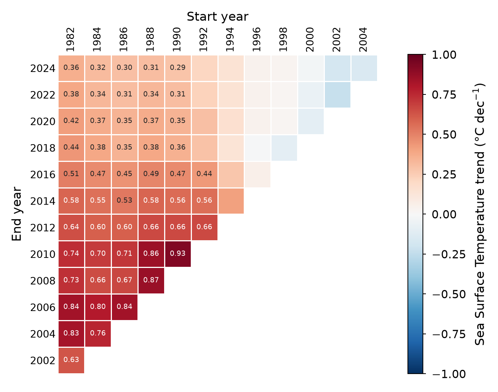

# Fig S — Sensitivity of the annual SST trend to the trend period



## Why this figure

A single SST trend for the waters off South Greenland depends strongly on the
years it is fitted over. The record contains a marked warm phase in the 2000s:
the annual mean peaks in 2010. A trend that ends during that phase is roughly
twice as steep as one that runs to the present. This supplementary figure shows
the full range of plausible trend estimates in one place, so that a trend quoted
in the main text (e.g. Fig 2) can be read in context. It shows two things:

- **Warming is robust.** Every period that starts between 1982 and 1990 gives a
  positive trend that is significant at 5 %. Over the longest period
  (1982–2024) the trend is **+0.36 °C dec⁻¹** (p < 0.001).
- **The magnitude is not robust.** The significant trends range from
  +0.29 to **+0.93 °C dec⁻¹** (1990–2010), depending mainly on the end year.
  From a 1992 start, only the periods ending in 2012–2016 are significant. No period
  starting in 1994 or later is significant, and those starting from 1996 on are
  near zero or slightly negative (down to −0.23 °C dec⁻¹), because they begin
  on the warm plateau.

## How to read it

Each cell is one trend period, with the **start year** on the top axis and the
**end year** on the left axis. Cell colour is the Theil–Sen slope of annual-mean
SST (°C dec⁻¹, on a colour scale symmetric about zero). The value is written
in the cell only where the Mann–Kendall test is significant (p < `alpha`).
The lower-right triangle is empty because periods shorter than `min_years` are
not evaluated. An optional caption in that space gives the region and the
minimum trend length (`plot.show_caption`).

With the current config (`min_years: 20`, `step_size: 2`), the grid has start
years 1982–2004 and end years 2002–2024. That gives 78 periods, 53 of which are
significant. Each trend is fitted on 21 to 43 annual values.

## Data

| Input (set in `config_S_SST_TREND_PERIODS.yaml` → `inputs`) | Contents | Source |
|---|---|---|
| `sst`: `../../data/sst_dmioi_monthly/sst_dmioi_monthly.zarr` | Monthly means of the daily L4 analysis: `analysed_st` (K) and `sea_ice_frac`, 1982–2025, 54.2–35.8° W, 58–67.75° N | DMI Arctic Ocean Sea and Ice Surface Temperature L4 REPROCESSED (AASTI v2), CMEMS product `SEAICE_ARC_PHY_CLIMATE_L4_MY_011_016`, dataset `cmems_obs_si_arc_phy_my_L4-DMIOI_P1D-m`. doi:10.48670/moi-00123; Nielsen-Englyst et al. (2023), *Remote Sens. Environ.* 284, 113331 |
| `region_mask`: `../../data/ocean_regions_mask/ocean_regions_mask.nc` | Ocean region classes (`region`; names in its `names` attr), shared with Fig 2a | `data/ocean_regions_mask/download_ocean_regions_mask.py` (`greenfjord.data.other.get_ocean_regions()`), from GEBCO 2023 bathymetry (doi:10.5285/f98b053b-0cbc-6c23-e053-6c86abc0af7b) and distance to coast |

Only region **1, "Oceanic (> 500 m deep)"**, is used (`analysis.ocean_regions`).
That is the off-shelf ocean, which excludes the near-shore band and the
shelf/fjord regions. See [`DATA_SOURCES.md`](../../DATA_SOURCES.md) (S4, S7) for
full citations.

## Methods

Implementation: `plot_S_SST_TREND_PERIODS.py`, which uses
`greenfjord.analysis.trends` and `greenfjord.analysis.seasonal_trends`.

1. **Ice masking.** Any pixel-month with sea ice (`sea_ice_frac > 0`) is
   dropped, so SST is only taken from open water. Values are converted from K to
   °C.
2. **Regional mean.** The region mask is interpolated (nearest neighbour) onto
   the SST grid. SST is then averaged over the selected region with
   cos(latitude) weights.
3. **Annual means.** The monthly series is averaged per calendar year, from
   `start_year` to `end_year`.
4. **Trend grid.** For every start year (1982, 1984, …) and every end year at
   least `min_years` later (in steps of `step_size`), a trend is fitted to the
   annual means of that window, endpoints included:
   `seasonal_trends.calc_trend_start_sensitivity`.
5. **Slope.** The Theil–Sen estimator (Sen, 1968), i.e. the median of all
   pairwise slopes (`scipy.stats.theilslopes`), is computed on the original
   annual series. It is scaled to °C per `trend_unit_per_years` years (10 = per
   decade).
6. **Significance.** The Mann–Kendall test (Mann, 1945; Kendall, 1975) is run as
   the p-value of Kendall's τ between SST and year (`scipy.stats.kendalltau`).
   Serial correlation is handled by trend-free prewhitening (TFPW; Yue et al.,
   2002), controlled by `analysis.prewhitening`:
   - `auto` (default): prewhiten only if the lag-1 autocorrelation ρ₁ of the
     detrended series exceeds the Anderson (1942) one-sided bound at `alpha`,
     `(−1 + z₁₋α·√(n−2)) / (n−1)`. That bound is ≈ 0.31 for n = 21 and ≈ 0.23
     for n = 43.
   - `force`: always prewhiten.
   - `off`: plain Mann–Kendall test on the original series.

   TFPW works in four steps:
   - detrend with the Theil–Sen slope *b*;
   - estimate ρ₁ from the residuals;
   - prewhiten them, `y′ₜ − ρ₁·y′ₜ₋₁`;
   - add `b·t` back.

   The test is then run on that series. The slope is always the one from the
   original series, as Yue et al. recommend. Cells with p < `alpha` (0.05) are
   annotated.

The trend cube is cached in `cache/`, e.g.
`sst-annual_trend_sensitivity-1982_2025-regions1-min20-step2-tfpw_auto-alpha0.05.nc`.
The filename encodes every analysis setting, so changing one recomputes it
automatically. **Delete the cache after changing the `inputs` paths**, since
those are not in the name.

**Effect of prewhitening here.** The annual series is only weakly
autocorrelated once detrended. ρ₁ is 0.38 for 1982–2024 and 0.24 for 1982–2002,
and it is ≈ 0 or negative for windows that start after 2000. The choice
therefore hardly matters. With the earlier `min_years: 15` grid, the counts of
significant cells were 73 (`off`), 72 (`auto`) and 71 (`force`).

## Caveats

- **Overlapping windows.** Neighbouring cells share most of their years, so
  they are not independent estimates. Read the figure as the sensitivity of a
  single trend estimate to its period, not as many separate trends.
- **No multiple-testing correction.** The meaningful signal is the contiguous
  block of significant cells, not any one cell.
- **TFPW is not conservative.** It can inflate type I error for short,
  autocorrelated series (Bayazit & Önöz, 2007; Serinaldi & Kilsby, 2016). The
  Hamed & Rao (1998) variance correction is the conservative alternative.
- **Ice masking changes the sampled area.** Pixels that are ice-covered in some
  months drop out of those months only, so the annual mean mixes slightly
  different areas from month to month. This matters little for the off-shelf
  region, but it is not a fixed-area mean.
- **2025 is in the data but not in the grid.** With `min_years: 20` and
  `step_size: 2`, every end year is even, so the last one is 2024. Use an odd
  `min_years` or `step_size: 1` to include 2025.

## Run

From the repository root:

```bash
MPLCONFIGDIR="$TMPDIR/mpl" .venv/bin/python figS-sst_seasonal_trends/plot_S_SST_TREND_PERIODS.py
```

All settings live in `config_S_SST_TREND_PERIODS.yaml`. Outputs:

- `fig_S_SST_TREND_PERIODS.<fmt>` for each of `output.formats` (default png and pdf), at `output.dpi`.
- With `output.save_csv: true`: `data_S_SST_TREND_PERIODS-slope.csv`, which
  holds the significant slopes laid out like the figure, and `-pvalue.csv`,
  which holds all p-values.

The layout started from `examples/Screenshot 2026-07-29 at 15.28.42.png`
(`examples/sst.ipynb`). That earlier version showed four seasonal panels in
K yr⁻¹, with dots marking significance.

## References

- Anderson, R. L. (1942) Distribution of the serial correlation coefficient.
  *Ann. Math. Stat.* 13, 1–13.
- Bayazit, M. & Önöz, B. (2007) To prewhiten or not to prewhiten in trend
  analysis? *Hydrol. Sci. J.* 52, 611–624.
- Hamed, K. H. & Rao, A. R. (1998) A modified Mann-Kendall trend test for
  autocorrelated data. *J. Hydrol.* 204, 182–196.
- Kendall, M. G. (1975) *Rank Correlation Methods*. Charles Griffin, London.
- Mann, H. B. (1945) Nonparametric tests against trend. *Econometrica* 13,
  245–259.
- Nielsen-Englyst, P. et al. (2023) Remote Sens. Environ. 284, 113331,
  doi:10.1016/j.rse.2022.113331.
- Sen, P. K. (1968) Estimates of the regression coefficient based on Kendall's
  tau. *J. Am. Stat. Assoc.* 63, 1379–1389.
- Serinaldi, F. & Kilsby, C. G. (2016) The importance of prewhitening in change
  point analysis under persistence. *Stoch. Environ. Res. Risk Assess.* 30,
  763–777.
- Yue, S., Pilon, P., Phinney, B. & Cavadias, G. (2002) The influence of
  autocorrelation on the ability to detect trend in hydrological series.
  *Hydrol. Process.* 16, 1807–1829.

Part of the GreenFjord overview-figures set.
