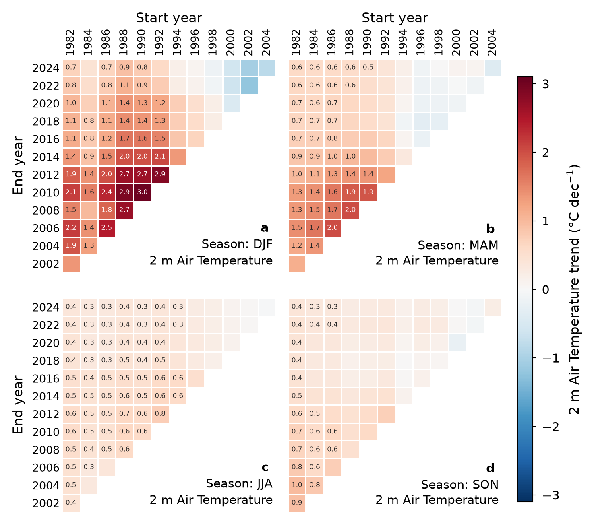

# Fig S — Sensitivity of seasonal 2 m air-temperature trends to the trend period



## Why this figure

A single air-temperature trend for the GreenFjord land area depends on the
years it is fitted over, and the dependence differs by season. This is the
air-temperature counterpart of
[`figS-sst_seasonal_trends`](../figS-sst_seasonal_trends/): it shows the range of
plausible trend estimates for each season in one place, so that a trend quoted
in the main text (e.g. Fig 2) can be read in context. It shows two things:

- **Warming is the rule for long periods.** Over the longest period (1982–2024) every season warms, at +0.73 (DJF),
  +0.61 (MAM), +0.38 (JJA) and +0.39 (SON) °C dec⁻¹ (p = 0.022, 0.0031,
  0.00015 and 0.0043).
- **The magnitude depends strongly on the period, most of all in winter.**
  DJF slopes range from −1.22 to **+3.03 °C dec⁻¹** (maximum for 1990–2010),
  against +0.77 °C dec⁻¹ at most in JJA. DJF is negative for 8 of 78
  periods, all of which start in 1998 or later. Windows that
  begin late miss the early warming.
  JJA is the most consistently significant season: 59 of its 78 periods are
  significant, against 50 in DJF, 41 in MAM and 23 in SON.

## How to read it

One panel per season (**a** DJF, **b** MAM, **c** JJA, **d** SON). Within a panel
each cell is one trend period, with the **start year** along the top (x axis)
and the **end year** down the left (y axis, latest end year at the top). Cell
colour is the Theil–Sen slope of the seasonal-mean 2 m air temperature
(°C dec⁻¹) on a colour scale shared by all panels and symmetric about zero,
with the colour bar on the right. Periods where the Mann–Kendall test is
significant (p < `alpha`, 0.05) are annotated with their slope (`plot.annotation`,
one decimal); the text is white on the darkest cells so it stays readable. The
filled periods form the upper-left triangle. The lower-right triangle is empty
(periods that end before they start, or are shorter than `min_years`, are not
evaluated), and the panel caption (letter, season, variable) sits there.

With the current config (`min_years: 20`, `step_size: 2`) the grid has start
years 1982–2004 and end years 2002–2024: 78 periods per season. The end years
step from 1982 + `min_years` in steps of `step_size`, so the last end year is
2024 and 2025 is not used. The shortest period (1982–2002) uses 21 seasonal values
and the longest (1982–2024) 43.

Winter dominates the shared colour scale: the colour limit is ±3.1 °C dec⁻¹
(the DJF maximum rounded up), so JJA and SON look pale. Set `plot.vmax` (e.g.
`2.0`) to clip the scale and bring out the weaker seasons; the colour bar then
grows arrows to show the clipping.

## Data

| Input (set in `config_S_T2M_TREND_PERIODS.yaml` → `inputs`) | Contents | Source |
|---|---|---|
| `era5`: `../../data/era5_monthly_south_greenland/era5_monthly_south_greenland.nc` | ERA5 monthly means on single levels, 1982-01 to 2025-12, 55–70° N, 80–30° W, 0.25° grid. Only `t2m` (K) is used; the time dimension is `valid_time` | ERA5 reanalysis, Copernicus Climate Change Service (C3S) / ECMWF; Hersbach et al. (2020), doi:10.1002/qj.3803. See the [dataset README](../../data/era5_monthly_south_greenland/README.md) |
| `region_polygons`: `../../data/greenfjord_land_ocean_ice/greenfjord_land_ocean_ice.gpkg` | Land (1), ocean (2) and ice (3) polygons, in that row order | Internal; produced by `fig2-sst_t2m_trends/examples/region_plots.ipynb`. Shared with Fig 2; see the [dataset README](../../data/greenfjord_land_ocean_ice/README.md) |

See [`DATA_SOURCES.md`](../../DATA_SOURCES.md) (S6, S8) for full citations.

The GreenFjord land polygon (`analysis.subset: "land"`) is used. Set it to
`"ocean"` or `"ice"` for the other two subsets used in Fig 2.

## Methods

Implementation: `plot_S_T2M_TREND_PERIODS.py`, which uses
`greenfjord.analysis.trends` and `greenfjord.analysis.seasonal_trends`.

1. **Crop.** The monthly `t2m` is renamed `valid_time` → `time`, restricted to
   `start_year`–`end_year`, converted from K to °C, and cropped to the bounding
   box of the region polygons.
2. **Regional mean.** The polygons are rasterised onto the ERA5 grid with the
   `xarray_raster_vector` `.rv.to_raster` accessor. `t2m` is averaged over the
   `subset` polygon with cos(latitude) weights.
3. **Seasonal means.** The monthly series is averaged to DJF, MAM, JJA and SON
   (`seasonal_trends.preprocess_data`, quarters starting in December) and
   reshaped to `year × season`. DJF is labelled with the year of its December,
   so DJF of year *Y* covers Dec *Y* to Feb *Y*+1. **Only complete seasons are
   kept.** The last DJF (Dec 2025 alone, since the data end in December 2025)
   is dropped, so DJF ends with the season labelled 2024 and the 1982–2025
   DJF trend would use 43 values rather than 44 (not on the current grid,
   whose last end year is 2024; there all seasons have 43 values).
4. **Trend grid.** For every start year (1982, 1984, …) and every end year at
   least `min_years` later (in steps of `step_size`), a trend is fitted to the
   seasonal means of that window, endpoints included:
   `seasonal_trends.calc_trend_start_sensitivity`.
5. **Slope and significance.** As in
   [`figS-sst_seasonal_trends`](../figS-sst_seasonal_trends/README.md#methods),
   described below.

### Trends and significance (methods text for the paper)

For every cell independently (implementation in
`greenfjord.analysis.trends`):

**Slope (cell colour).** Theil–Sen (Sen, 1968) slope, the median of the slopes
of all pairwise point combinations, from `scipy.stats.theilslopes` on the
original, unfiltered seasonal series. It is scaled to °C per
`trend_unit_per_years` years (10 = per decade). It is rank-based, so single
extreme years do not dominate short windows. The 95 % Theil–Sen bounds are
stored in the cached cube but not drawn.

**Significance (annotated values).** The Mann–Kendall test (Mann, 1945; Kendall, 1975) is
run as the p-value of Kendall's τ against year (`scipy.stats.kendalltau`,
`variant="c"`). Serial correlation is handled by trend-free prewhitening (TFPW;
Yue et al., 2002), controlled by `analysis.prewhitening`:

- `"auto"` (default): prewhiten only where the lag-1 autocorrelation ρ₁ of the
  detrended series exceeds the Anderson (1942) one-sided bound at `alpha`,
  `(−1 + z₁₋α·√(n−2)) / (n−1)`. That bound is 0.31 for n = 21 and 0.23 for n = 43.
- `"force"`: always prewhiten.
- `"off"`: plain Mann–Kendall test on the original series.

TFPW works in four steps: estimate the Theil–Sen slope *b* and detrend; estimate
ρ₁ from the residuals; prewhiten them (`y′ₜ − ρ₁·y′ₜ₋₁`); add the original trend
`b·t` back. The test is then run on that series. The slope is always the one
from the original series, as Yue et al. recommend. Cells with p < `alpha` get their
slope written in.

**Cache.** The trend cube (`start_year × end_year × season × parameter`) is
cached in `cache/`, e.g.
`t2m-seasonal_trend_sensitivity-land-1982_2025-min20-step2-tfpw_auto-alpha0.05.nc`.
The filename encodes every analysis setting that changes the numbers (`subset`,
`start_year`, `end_year`, `min_years`, `step_size`, `prewhitening`, `alpha`), so
changing one recomputes it automatically. **Delete the cache after changing the
`inputs` paths or the files behind them**, since they are not in the name.
Recomputing takes a few seconds.

**Effect of prewhitening here.** Air temperature has weak year-to-year memory
once detrended, so `"auto"` prewhitens in few windows. Compared with `"off"`,
`"auto"` changes the p-value in 11 of 78 cells in DJF and in none in MAM, JJA
or SON; slopes are identical by construction. Significant cells are 45 (`off`),
50 (`auto`) and 51 (`force`) in DJF. In the other seasons `off` and `auto`
agree (MAM 41, JJA 59, SON 23 significant cells), while `force` lowers the
count (MAM 36, JJA 54, SON 11), because ρ₁ is negative for the long JJA and SON
windows (−0.31 and −0.25 for 1982–2024) and prewhitening then costs power. ρ₁ for 1982–2024 in DJF is
0.20, just under the n = 43 bound of 0.23; only DJF windows whose ρ₁ clears
the bound are prewhitened, and these are the cells that change.

## Caveats

- **Overlapping windows.** Neighbouring cells share most of their years, so they
  are not independent estimates. Read the figure as the sensitivity of the trend
  estimate to its period, not as many separate trends.
- **No multiple-testing correction.** There are 78 overlapping periods per
  panel and four panels sharing years, so the contiguous *block* of significant
  cells is the interpretable signal rather than any individually annotated cell.
- **TFPW is not conservative.** It can inflate type I error for short,
  autocorrelated series (Bayazit & Önöz, 2007; Serinaldi & Kilsby, 2016),
  consistent with DJF gaining significant cells under `"auto"` (45 → 50). The Hamed & Rao
  (1998) variance correction is the conservative alternative.
- **Incomplete last season.** A season needs all three months, so the DJF
  starting in December 2025 is dropped. This does not affect the figure, since
  the last end year is 2024.
- **Reanalysis, not observations.** Trends of ERA5 2 m temperature depend on the
  reanalysis and on the land polygon; the polygon mean mixes the coarse 0.25°
  grid cells that fall inside it.
- **Cache keys.** Delete the cache after changing `inputs` (see Methods).

## Run

From the repository root:

```bash
MPLCONFIGDIR="$TMPDIR/mpl" .venv/bin/python figS-t2m_seasonal_trends/plot_S_T2M_TREND_PERIODS.py
```

All settings live in `config_S_T2M_TREND_PERIODS.yaml`. Outputs:

- `fig_S_T2M_TREND_PERIODS.<fmt>` for each of `output.formats` (default png and
  pdf), at `output.dpi`.
- With `output.save_csv: true`: `data_S_T2M_TREND_PERIODS-slope.csv`, which holds
  the significant slopes, and `-pvalue.csv`, which holds all p-values. Each has
  one block per season, laid out like the figure (rows = end year, latest
  first; columns = start year; empty where there is no period).

Config switches that matter: `analysis.subset` (`"land"`, `"ocean"`, `"ice"`),
`analysis.prewhitening` (`"auto"`, `"force"`, `"off"`), `analysis.alpha`,
`analysis.min_years` / `step_size` (the trend grid), `plot.vmax` (`null` = data
range) and `output.save_csv`.

## References

- Anderson, R. L. (1942) Distribution of the serial correlation coefficient.
  *Ann. Math. Stat.* 13, 1–13.
- Bayazit, M. & Önöz, B. (2007) To prewhiten or not to prewhiten in trend
  analysis? *Hydrol. Sci. J.* 52, 611–624.
- Hamed, K. H. & Rao, A. R. (1998) A modified Mann-Kendall trend test for
  autocorrelated data. *J. Hydrol.* 204, 182–196.
- Hersbach, H. et al. (2020) The ERA5 global reanalysis. *Q. J. R. Meteorol.
  Soc.* 146, 1999–2049, doi:10.1002/qj.3803.
- Kendall, M. G. (1975) *Rank Correlation Methods*. Charles Griffin, London.
- Mann, H. B. (1945) Nonparametric tests against trend. *Econometrica* 13,
  245–259.
- Sen, P. K. (1968) Estimates of the regression coefficient based on Kendall's
  tau. *J. Am. Stat. Assoc.* 63, 1379–1389.
- Serinaldi, F. & Kilsby, C. G. (2016) The importance of prewhitening in change
  point analysis under persistence. *Stoch. Environ. Res. Risk Assess.* 30,
  763–777.
- Yue, S., Pilon, P., Phinney, B. & Cavadias, G. (2002) The influence of
  autocorrelation on the ability to detect trend in hydrological series.
  *Hydrol. Process.* 16, 1807–1829.

Part of the GreenFjord overview-figures set.
